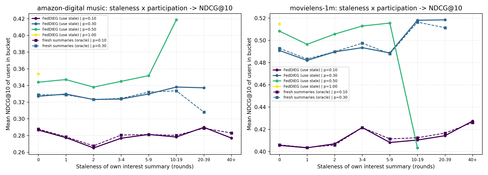
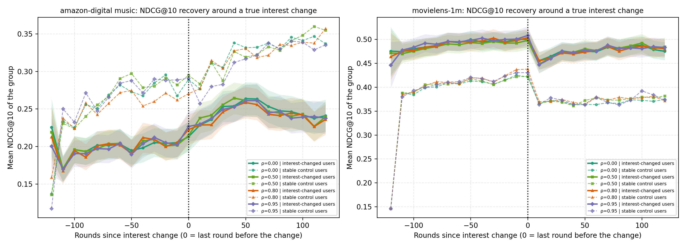
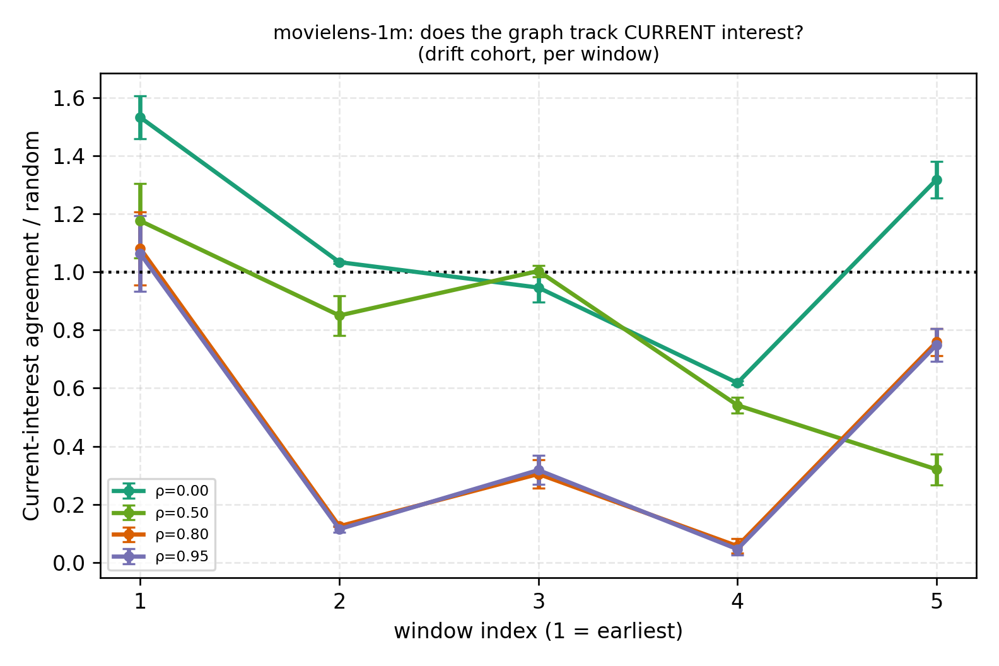
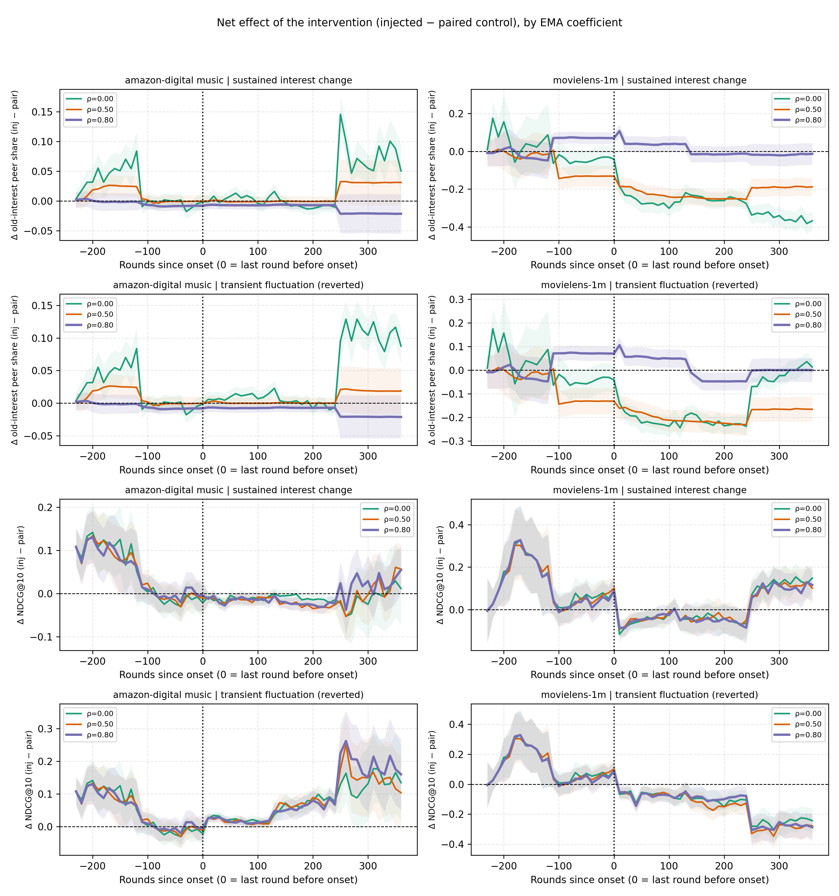
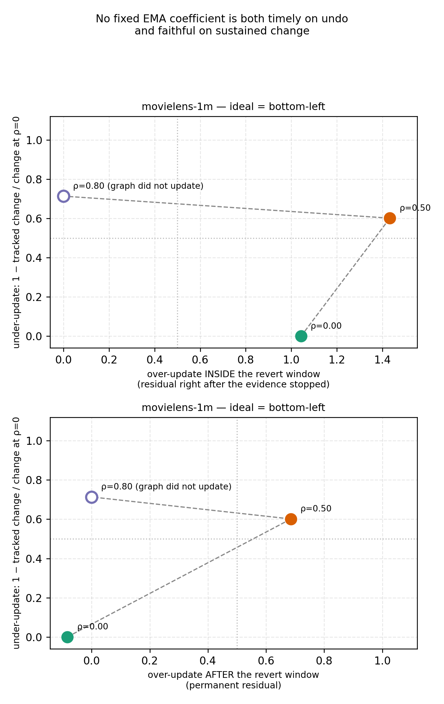

# 动态联邦推荐研究问题验证报告（第一阶段）

| 项 | 内容 |
|---|---|
| 课程/课题 | FedDIEG：面向用户兴趣演化的联邦动态图推荐 |
| 对应任务书 | `2026-10-26 动态联邦推荐研究问题验证任务书.md` |
| 阶段 | 第一阶段（只验证问题是否存在，不设计新算法） |
| 截止日期 | 2026-11-04 |
| 报告日期 | 2026-11-04 |
| 数据位置 | `exp_val_1026/exp01_staleness_participation/`、`exp02_ema_interest_drift/`、`exp03_transient_vs_sustained/` |
| 实验规模 | **144 次正式训练运行**（exp01 36 + exp02 72 + exp03 36，每个网格均为 3 个独立随机种子）+ 24 次前置检验运行 + 2 次 §3 的诊断性复现运行 |
| 数据集 | MovieLens-1M + amazon-digital music（任务书要求"先两个数据集"） |
| 目标期刊 | Expert Systems with Applications（备选 KBS） |

---

## 摘要：本阶段最重要的五条结论

1. **"摘要陈旧性损害推荐效果"在本实验条件下基本不成立（停止信号 1 命中）。**
   把服务器缓存的陈旧摘要换成"此刻重算的新鲜摘要"（不可部署的 oracle 上界），MovieLens-1M 上只挽回 **+0.0013 NDCG@10**（p=0.10 与 p=0.30 均为 −0.0013，3/3 种子同号），仅占参与率损失的 **1.2%**；
   而参与率从 100% 降到 10% 会掉 **−0.108**。同时缓存摘要本身漂移极小：最陈旧桶（约 49 轮未更新）与新鲜摘要的余弦仍有 **0.944**。
   → 参与率下降造成的损失**几乎全部来自"训练机会变少"，而不是"摘要变旧"**。

2. **"兴趣真实变化时固定 EMA 更新太慢"方向反了。**
   在把图影响放大到可观测的配置下（strong 组，8 个实现×ρ 组合），**图的总变动量（turnover）越大，兴趣变化组 NDCG 越低，r = −0.970**；
   同时 turnover 越大关系兴趣一致度越高，r = +0.945；而一致度越高 NDCG 越低，r = −0.911。
   我们原以为的失效（"该更新时更新太慢"）在数据上是**相反**的：真正存在的是一条**反向权衡**——让关系更贴合兴趣的那种图，推荐指标更差。

3. **"短期波动导致不必要的图更新"在论文默认 ρ=0.8 下根本没有发生。**
   一个窗口的短期扰动对关系图的净影响只有 **0.014**（ρ=0 时 0.164），因为 EMA 让新邻居进不了 Top-K（ECR 0.0014/轮 vs 0.161）——图处于**冻结**状态。
   只有当 ρ→0 时图才跟着扰动走，且问题不是"永久污染"而是"**晚一个窗口才撤销**"（撤销窗口内残留为扰动幅度的 1.05 倍，下一窗口恢复）；ρ=0.5 时残留**永不消失**（0.64 倍，3/3 种子）。

4. **最关键的一条排除性证据：推荐损失与"图有没有更新"脱钩。**
   短期扰动造成的 NDCG 损失（+0.18~0.22）在 ρ=0/0.5/0.8 上几乎完全相同（0.195/0.218/0.183，Wilcoxon p=0.12~0.22），
   与图的关系质量变化也不相关（逐对 r = −0.09~−0.27，**符号为反**），而同期图的关系质量变化相差 **12 倍**。
   由于 ρ=0.8 下图被证实几乎不动，这一"不变性"构成排除性证据：**损失来自客户端兴趣摘要的累积方式（一次性证据被永久写进历史摘要，1−cos 残余比 1.49 不回落），而不是边权更新规则。**

5. **因此：原假设的三条具体失效（陈旧、过慢、过度更新）都不成立；但"协同关系是否仍然可信"这个问题成立，并且已经可以量化。**
   在 ρ≥0.5 时，图与用户**当前**兴趣几乎无关（邻居兴趣一致度 `cur_peer_share` 仅 0.06~0.30，**低于随机水平 1.0**）；持续兴趣变化只被跟上 **22%~29%**。
   这些失效在 NDCG 上看不出来，因此论文的 claim 必须从"推荐性能会下降"改写为"**关系可信度会失效**"，否则会被审稿人用本报告的数据直接反驳。

> **对任务的诚实回答：** 第一阶段没有证明我们原来的故事，反而**证伪了它的一半**。这符合任务书第八节"通过实验排除一个不值得继续研究的方向"的意图，但也意味着第二阶段的算法动机必须重写（第 8、11 节给出可判定的新目标与止损线）。

---

## 0. 三条前置说明（请在读实验细节前先看）

1. **口径**：本报告所有"效应"均指**配对差值**（同种子、同参与序列、同用户配对），不是跨组绝对值的比较。阈值沿用实验脚本内置判定：|效应| ≥ 0.005 视为实质性，< 0.002 视为可忽略（与种子噪声同量级）。3 个种子只能看方向一致性（3/3 同号），不做显著性推断。
2. **不可部署的对照**：exp01 的 `upload_fresh_edges`、exp03 的注入 arm 都是**诊断用 oracle**，只能读作"上界/净效应"，不能当作可上线方案。
3. **仿真边界**：本仓库的 runner 是"单模型快速仿真"，不是真正的 per-client FedAvg（`exp_01_fast_gpu/run_exp01_fast_gpu.py` 文件头明确写着 "intentionally separate from the original per-client FedAvg code"）。因此本报告审计的是**兴趣摘要与动态图这条数据通路**，参数聚合通路的隐私风险只能定性讨论（第 9 节）。

---

## 1. 任务与交付核对

任务书第六节列了 6 项必交内容，逐项核对如下：

| # | 任务书要求 | 本报告位置 | 状态 |
|---|---|---|---|
| 1 | 说明 FedDIEG 如何维护兴趣摘要缓存、更新边权、未参与客户端摘要如何被使用 | §2 | ✅ 代码级核对 |
| 2 | 核对中期报告表 3 和表 6 默认设置结果为什么不一致 | §3 | ✅ 已定位到两个不同实现 + 两套默认超参，并做了 2 次复现实验 |
| 3 | 客户端参与率与摘要陈旧程度的初步分析 | §4（exp01，36 次运行） | ✅ 含三项前置检验 |
| 4 | 固定 EMA 系数在兴趣变化场景下的对比 | §5（exp02，72 次运行，5 组×4 个 ρ） | ✅ 并额外发现 turnover 中介的反向权衡 |
| 5 | 持续兴趣变化与短期扰动对动态图的不同影响 | §6（exp03，36 次运行，注入+真实双 arm） | ✅ |
| 6 | 整理服务器接收的用户信息与潜在隐私泄漏风险 | §9 | ✅ 审计完成，量化攻击实验列为下一步 |
| — | 每组实验说明设置/控制变量/图表/现象/其他解释/结论 | §4.1–4.6、§5.1–5.6、§6.1–6.8 | ✅ |
| — | 先两个数据集、3 个独立随机种子 | 全部 | ✅ |
| — | 回答三个问题 | §7 | ✅ |
| — | 指出何时应停止 | §8 | ✅ |

**未覆盖项（主动声明）**：exp01 的 README 中已注明，任务书观察点③（"陈旧摘要参与的边是否更易成为坏邻居"）与观察点④（"图是否该更新却没更新"）在 exp01 里没有做，因为它需要边级真值快照与 lag 指标。
本报告用 **exp03 的 `old_peer_share` / `turnover` / `over_update` / `under_update`** 补上了观察点③④的证据（§6），但没有在 exp01 的参与率维度上重做，这一点是明确的缺口（见 §10 局限 3）。

---

## 2. 现有 FedDIEG 机制审计（交付项 1）

### 2.1 兴趣摘要缓存：服务器存什么、谁更新它

代码位置：`exp_val_1026/exp01_staleness_participation/val01_run_staleness.py` L516–L553、L641–L653；基础实现 `exp_01_fast_gpu/run_exp01_fast_gpu.py` L726–L750。

```python
summary_bank  = zeros(N_users, 64)     # 服务器端"兴趣摘要缓存"，一行一个客户端
active_clients= zeros(N_users, bool)   # 是否曾经上传过
last_upload_round = full(N_users, -1)  # 上次上传的训练轮次（用于算陈旧度）
n_uploads     = zeros(N_users, int32)  # 累计上传次数
```

每轮**只有被抽样参与训练的客户端**刷新自己的摘要（L641–L651）：

```python
new_memory = short_summary.detach()                  # 客户端本地算出的 64 维兴趣摘要
momentum   = feddieg_memory_momentum                 # 论文配置 0.8
summary_bank[u] = seen*(momentum*summary_bank[u] + (1-momentum)*new_memory) \
                + (1-seen)*new_memory                # seen=0（首次上传）时直接替换
last_upload_round[u] = global_round
n_uploads[u] += 1
```

- `short_summary` 的来源（`run_exp01_fast_gpu.py` L524–L531）：SASRec 序列表示经过一层 `tanh(W_proj)` + 可学习 query 注意力池化得到，维度 = `latent_dim = 64`。**它不是原始交互，也不是物品 ID 列表，而是一个 64 维向量。**
- 陈旧度定义（L548–L553）：`staleness[u] = global_round − last_upload_round[u]`；从未上传过的客户端记为一个特殊大值（`NEVER_UPLOADED`）。
- 关键性质：**摘要的更新是"积分式"的**（momentum 0.8），没有遗忘机制，也不区分"这条新证据只出现了一次"还是"连续出现"。这一点在 §6 成为解释推荐损失的核心理由。

### 2.2 边权更新：Top-K + 阈值 + EMA + 重归一化

代码位置：`val01_run_staleness.py` L219–L314（本仓库里最完整、最贴近论文描述的实现）。

每一轮，对被抽样用户 `u`：

1. **候选池** = 所有 `active_clients`（只要历史上上传过一次就算），用**缓存摘要**两两算余弦 `sim = cos(h_u, h_v)`，自身置 0；
2. **EMA 平滑**：`sim ← (1−ρ)·sim + ρ·prev_weight`（只对该行已有的邻居生效；ρ = `edge_ema`，默认 0.80）；
3. **Top-K**（K = 10）+ **阈值**（`sim ≥ min_sim = 0.20`）；
4. **重归一化**：保留下来的边权 `w_i / Σ w`，使每行和为 1（注意：**边权是相对权重，不是绝对强度**）；
5. 记录本行边集合变化率 **ECR**（与上一轮邻居集合的 Jaccard 距离）。

有三点必须写进论文，否则复现者一定会掉进坑里：

- **新边采用 warm start**（L294–L299 及注释）：新出现的边直接以第一次观测值入场，否则 `min_sim > (1−ρ)·cos_max` 会让图**永远为空**。
- **只有被抽样用户的行被重算**（`update_scope = sampled`）。未被抽到的客户端，其邻居行**整行冻结**，但它的摘要仍留在候选池里被别人选。
- **Top-K + min_sim 是硬截断**：一旦某条边掉出 Top-K，它的历史权重就丢了；ρ 越大，新邻居越难挤进 Top-K。这正是 §5、§6 中"高 ρ 图冻结"的机制来源。

### 2.3 未参与客户端的摘要被"用了三次"

这是任务书点名要说明的一点，本仓库里确实有三条通路：

| 通路 | 代码 | 后果 |
|---|---|---|
| ① 作为**别人的候选邻居** | L238–L258：候选池 `active = active_clients`，包含长期未更新的客户端 | 陈旧摘要会把别人"吸"过去（或排斥掉），而它自己不参与更新 |
| ② 作为**自己的冻结邻居行** | L239：只重算 `update_users`；`graph_neighbors`/`graph_weights` 其余行原样保留 | 未参与者的 GNN 聚合用的是很久以前那张图 |
| ③ 作为**自己的冻结摘要输入** | L216：`summary_bank[neighbors]`；评测时对全部用户取行 | 未参与者的表示仍由旧摘要+旧图决定 |

换言之，**"陈旧"不是通过一条边传播的，而是通过三条通路叠加**：旧摘要既污染别人的邻居选择，又让本人的图与自己都停止演化。
这也解释了为什么我们设计的对照必须"只换摘要新鲜度、不动参与序列"——否则分不清是① 摘要旧、还是② 训练少。

### 2.4 模型侧如何使用这些边（图信号其实被压得很小）

`run_exp01_fast_gpu.py` L543–L573 与 L575–L592（下面是**等价简化示意**，不是原文）：

```python
g_i = ReLU( Σ_j w_ij · W_gnn(h_j) )                  # 邻居消息聚合
graph_delta = LayerNorm(W_g(g_i))
graph_delta = sigmoid(MLP([h_i, graph_delta])) * graph_delta        # 门控
graph_delta *= (max_j w_ij)^confidence_power                       # confidence 门控
graph_delta *= max(0, cos(h_i, g_i))^agreement_power               # agreement 门控
feats = seq_emb + graph_mix * graph_delta * tail_power_position_weight
score_feats = fused + short_score_mix*gate*short_delta + score_local_mix*base_feats
```

论文默认（`graph_mix = 0.2`、`tail_power = 4`、confidence/agreement 0.5/0.5、`score_local_mix = 0.2`）下，图信号经过**四道衰减**：`graph_mix` 缩放 + `tail_power` 只放大序列尾部 + 两道门控 + 打分阶段 20% 回拉到局部特征。
这解释了本报告反复出现的现象：**在默认配置下，图的任何变化在 NDCG 上几乎都看不见**（§5 实测 paper 强度下 ρ 极差 ≤0.003，与种子噪声同量级）。

### 2.5 三套实现的差异（这是 §3 的关键）

| 实现 | 文件 | 图更新方式 | 是否有持久图/EMA |
|---|---|---|---|
| exp01 / val01 / val02 | `run_exp01_fast_gpu.py`、`val01_run_staleness.py`、`val02_run_ema.py` | 持久 `graph_neighbors/weights` 行 + EMA（ρ 可设） | 有（ρ 默认 0.8） |
| exp02（**中期报告表 1/2/3 的来源**） | `exp_02_fast_gpu/run_exp02_fast_gpu.py` L447、L691 | **每次调用 `build_weighted_neighbors()` 现场算 kNN**，无历史、无 ρ | **没有**（等价 ρ=0 且无记忆） |
| exp03 / exp05（**表 4/5/6 的来源**） | `exp_03_fast_gpu/run_exp03_fast_gpu.py` L349–L419 | 持久行 + EMA（`edge_ema` 默认 0.8）+ boundary refresh | 有 |

> 这一条不是"配置差异"，是**两个不同机制的实现**。它是 §3 那个数字不一致的第一位原因，也是论文必须交代的复现性问题。

### 2.6 小结（给论文用的两句话）

- FedDIEG 的动态图是**"缓存摘要 + 相对边权"**的结构：服务器只知道每个用户最后一次上传的 64 维摘要，边权是这些摘要的余弦经 Top-K、阈值、EMA、重归一化后的相对权重。
- 因此"该不该更新一条边"在实现上被压缩成两个数：**摘要是否新旧（staleness）**与**一个全局标量 ρ**；**而"这条新证据可不可靠"完全没有进入机制**——这正是第二阶段要补的位置（也与 §6 的结论一致）。

---

## 3. 交付项 2：中期报告表 3 与表 6 的"默认设置"为什么不一致

### 3.1 不一致的事实

| 位置 | 方法名 | MovieLens-1M 指标 | 数值 |
|---|---|---|---|
| 中期报告 **表 3**（动态窗口鲁棒性） | FedDIEG（"默认"） | Avg Window NDCG@10 | **0.4224 ± 0.0028**（5 种子） |
| 中期报告 **表 4**（实验 2 消融） | Ours（完整模型） | Avg Window NDCG@10 | **0.4224 ± 0.0028**（5 种子） |
| 中期报告 **表 6**（参数敏感性，"†"=默认） | FedDIEG，K=10† / ρ=0.8† / λ₁=0.01† | Avg. NDCG@10 | **0.4091**（无 ±，单种子） |

同一模型、同一数据集、同一"动态窗口"协议，**相差 0.0133**，且表 6 的三个"†"行彼此完全相同（说明确实是同一个 default 作业）。

### 3.2 追到产物：两个数字来自两个不同的 runner 和两套默认超参

| | 表 3 / 表 4 的 Ours | 表 6 的 default |
|---|---|---|
| 产物文件 | `exp_02_fast_gpu/significance_exp02/results/movielens-1m/multiseed_summary.csv`（`0.4224 +- 0.0028`） | `exp_05_sensitivity/final/movielens_1m/default/exp03_summary.csv`（`0.4091497`） |
| runner | `run_exp02_fast_gpu.py` | `run_exp03_fast_gpu.py` |
| 图机制 | **无状态 kNN**（无持久边、无 EMA） | **持久图 + EMA ρ=0.8** |
| 种子 | **5 个**（42 / 777 / 1234 / 2024 / 3407） | 1 个（42） |
| 记录产物 | `.../seed_1234/feddieg/config.json`（旧 schema，字段不全） | `.../default/config.json`（完整） |

逐字段差异（只列不同项）：

| 字段 | 表 3（exp02 tuned） | 表 6（exp05 BASE_FEDDIEG） | 影响 |
|---|---|---|---|
| `lr` | **0.0012** | 0.001 | 全局学习率 |
| `feddieg_graph_mix` | **0.005**（正式 final 用 0.02） | 0.05 | 图信号强度 |
| `feddieg_warmup_rounds` | **100** | 20 | 图何时启用 |
| `feddieg_final_loss_weight` | **0.0** | 0.2 | 训练目标组成 |
| `feddieg_short_score_mix` | **0.0** | 0.05 | 打分阶段短期融合 |
| `feddieg_confidence_power` | **0.0**（关） | 0.5 | 可靠性门控① |
| `feddieg_agreement_power` | **0.0**（关） | 0.5 | 可靠性门控② |
| `feddieg_score_local_mix` | **0.0**（关） | 0.2 | 打分回拉 |
| `feddieg_boundary_refresh_rate` | **0.0**（关） | 0.3 | 窗口边界摘要刷新 |
| `feddieg_neighbor_temp` | **0.05** | 0.07 | 边权 softmax 温度 |
| 图机制 | 无持久边 / 无 ρ | 持久边 + ρ=0.8 | **机制不同** |
| 种子数 | 5（→ ±0.0028） | 1 | ± 的来源 |

> 注：`clients_per_round` 在表 3 里显式记作 604，表 6 记作 null，但两者实际都是 604（0.1×6040）；`min_sim`、`neighbors`、`tail_power`、`memory_momentum`、`candidate_count=99`、5 窗口×120 轮**都相同**。

**结论：表 3 与表 6 报的是"同名不同物"的模型。**
表 3 的 FedDIEG 是"per-dataset 调过参、且**图影响被压到 `graph_mix=0.005`（正式 final 为 0.02）、并且根本没有 EMA 持久图**"的版本；
表 6 的 default 是"敏感性分析的基准配置（`graph_mix=0.05`、两道门控开、`score_local_mix=0.2`、`boundary_refresh=0.3`、EMA ρ=0.8）"的版本。
所以 0.0133 的差**不是统计口径问题**（两者都是 5 窗口平均 NDCG、99 负样本、p=0.1），而是**实现 + 超参**问题。

### 3.3 四次运行给出的完整分解（本次新增 2 次）

为把"超参"与"实现"分开，在同一台机器、同一份数据、同一 seed=42 下补跑了两次（命令见附录 B）：

| 实验 | runner（图机制） | 超参 | Avg Window NDCG@10（seed 42） |
|---|---|---|---|
| B0（已有产物） | exp03（**持久图 + EMA ρ=0.8**） | BASE_FEDDIEG | **0.40915** |
| B1（已有产物） | exp02（**无状态 kNN 图**） | tuned（graph_mix 0.005、门控关、warmup 100、final_loss 0、short_score 0、lr 0.0012） | **0.42497** |
| B2（本次新增） | exp03（持久 EMA 图） | tuned 的可调部分（lr 0.0012、graph_mix 0.02、门控关、local_mix 关、boundary 关、short_score 0、temp 0.05） | **0.41214** |
| B3（本次新增） | exp02（无状态 kNN 图） | BASE_FEDDIEG | **0.39055** |

（B1 取 `significance_exp02/.../seed_42` 的 0.42497；表 3 报的 0.4224 ± 0.0028 是同一配置在 5 个种子上的均值，其 seed-42 值即 0.42497。B0 与 exp05 的 default 作业同配置，0.40915 与记录值 0.4091497 一致。）

由此可以读出三个**单因素**效应量（都远大于种子噪声 ±0.0028）：

| 对照 | 只改变了什么 | Δ NDCG@10 |
|---|---|---|
| B2 − B0 | **超参**（固定 exp03 机制） | **+0.0030** |
| B1 − B3 | **超参**（固定 exp02 机制） | **+0.0344** |
| B0 − B3 | **机制/runner**（固定 BASE 超参） | **+0.0186** |
| B1 − B0 | 机制 + 超参（= 两表实际报的东西） | +0.0158 |

### 3.4 最终判断

1. **两表数字都真实、都可复现**：B1（0.42497）就是表 3 的 seed-42 值（表 3 = 5 种子均值 0.42236）；B0（0.40915）与 exp05 记录一致到 5 位小数；B2/B3 均可稳定重跑。
2. **差距不是统计口径问题**：两者都是 5 窗口平均 NDCG、99 负样本候选、参与率 0.1、实际客户端数 604、5×120 轮。
3. **也不是"某一个超参没调对"**：**超参效应与图机制存在强交互**——同一套 tuned 超参在 exp02 机制上值 **+0.034**，在 exp03 机制上只值 **+0.003**；而在 BASE 超参下，两套机制本身相差 **0.019**。
4. **方向也说明问题**：表 3 的高分主要来自"**把图关小、把关控关掉**"（`graph_mix` 0.005、confidence/agreement 关、`score_local_mix` 关、`short_score_mix` 关）；在 exp02 机制下，把这些打开（B3）会掉 0.034。
   → **因此不能用表 3 的 0.4224 证明"动态图带来了跨窗口鲁棒性"**：那个配置下图对打分的贡献近乎为零。这与 §5 的独立发现（paper 强度下图信号被四道衰减压到 1e-3 量级）一致。
5. **表 4 的 Ours 行（0.4224 ± 0.0028）与本仓库同协议下的 Ours-Full（`exp_03_fast_gpu/final`，0.4092）不一致**，且 StaticGraph / NoDecay 两行在全部 csv 中**零命中**（无原始产物可追溯）。

> **§3 的最终答案（可直接写进汇报）：**
> 表 3 与表 6 的"默认设置"**既不是同一个配置，也不是同一套实现**：表 3 = `exp02 runner`（无状态 kNN 图，ρ 根本不存在）+ per-dataset tuned 超参 + 5 种子；表 6 = `exp03 runner`（持久图 + EMA ρ=0.8）+ 敏感性分析基准超参 + 单种子。
> 两者在**相同名义超参**下就已相差 0.019，叠加超参后净差 0.0133（表 3 更高，但增益主要来自"关掉图/关掉门控"）。
>
> **整改要求**：(a) 表 3 必须标注"per-dataset 调参配置"；(b) 表 6 的 † 行必须注明"敏感性分析基准配置"；(c) 统一 runner 后重跑表 3/表 4，并在论文中声明"ρ 的语义只存在于含持久图的那套实现里"——否则表 3 无法支持任何关于 EMA 的论断；(d) 论文中"默认设置"只保留一个定义。

---

## 4. 实验一：客户端长期不参与，会不会影响推荐质量？（exp01）

### 4.1 设置

| 项 | 内容 |
|---|---|
| 目录 | `exp_val_1026/exp01_staleness_participation/` |
| 规模 | 2 数据集 × 2 模式 × {100%,50%,30%,10%} × 3 种子 = **36 次运行**（新鲜摘要对照只在 30%/10% 跑，因为 100% 时不存在陈旧） |
| 预算 | 5 个滚动时间窗口 × 120 轮，`eval_every=10`，99 负样本候选，`top_k=10` |
| 主模型配置 | ρ(`edge_ema`)=0.80，K=10，`min_sim`=0.20，`tail_power`=4.0，confidence/agreement=0.5，`score_local_mix`=0.2，`graph_mix`=0.05，`memory_momentum`=0.8，lr=0.001 |
| 两个模式 | `upload_only`（现状：只有参与训练的客户端刷新摘要，陈旧摘要照样参与构图）<br>`upload_fresh_edges`（对照：每轮给全部客户端重算摘要 → **不可部署的 oracle 上界**） |

### 4.2 控制变量（这是本实验唯一能得出因果结论的理由）

- 两个模式**共用同一份预生成的参与序列**（同一种子下逐轮完全一致 → "训练机会"被固定）；
- 唯一改变的是"服务器是否使用陈旧摘要参与构图/聚合"；
- `upload_fresh_edges` 只用**当前窗口已到达**的交互重算摘要，不引入未来窗口数据；
- 判定只用**同种子的配对差值**，不用逐用户相关性（陈旧度与上传次数天然负相关，逐用户相关性主要反映训练机会）。

### 4.3 图表

主图（任务书要求的交付物）：`exp01_staleness_participation/results/aggregated/figures/val01_fig_staleness_rate.png`
（横轴 = 摘要陈旧程度分桶，每条实线 = 一个参与率，虚线 = 新鲜摘要对照，纵轴 = 平均 NDCG@10）



下表只列关键桶（MovieLens-1M 全 8 桶、amazon 取 3 桶；完整数据见 `results/aggregated/tables/val01_figure_data.csv`，"—" 表示该桶样本不足或无该运行）：

| 数据集 | 陈旧度桶 | NDCG@10（p=0.10，现状） | NDCG@10（p=0.10，新鲜摘要） | NDCG@10（p=0.30，现状） | NDCG@10（p=0.30，新鲜摘要） |
|---|---|---|---|---|---|
| MovieLens-1M | 0 | 0.4056 | 0.4061 | 0.4908 | 0.4928 |
| MovieLens-1M | 1 | 0.4034 | 0.4036 | 0.4819 | 0.4832 |
| MovieLens-1M | 2 | 0.4070 | 0.4059 | 0.4896 | 0.4898 |
| MovieLens-1M | 3–4 | 0.4216 | 0.4215 | 0.4934 | 0.4975 |
| MovieLens-1M | 5–9 | 0.4082 | 0.4114 | 0.4886 | 0.4880 |
| MovieLens-1M | 10–19 | 0.4104 | 0.4124 | 0.5180 | 0.5163 |
| MovieLens-1M | 20–39 | 0.4143 | 0.4166 | 0.5184 | 0.5113 |
| MovieLens-1M | 40+ | 0.4274 | 0.4261 | —（样本不足） | — |
| amazon-digital music | 0 | 0.2865 | 0.2876 | 0.3270 | 0.3288 |
| amazon-digital music | 10–19 | 0.2781 | 0.2801 | 0.3381 | 0.3335 |
| amazon-digital music | 40+ | 0.2769 | 0.2829 | — | — |

参与率效应与陈旧损失（`results/aggregated/tables/val01_verdict.csv`，3 种子配对）：

| 数据集 | 参与率效应 ΔNDCG@10（p=0.10 − p=1.00） | 陈旧信息造成的损失（现状 − 新鲜），p=0.10 | 同，p=0.30 | 陈旧占参与率损失 |
|---|---|---|---|---|
| MovieLens-1M | **−0.10838 ± 0.00316**（负 3/3） | **−0.00135 ± 0.00078**（负 3/3，**不显著**） | **−0.00135 ± 0.00083**（负 3/3） | **1.2%** |
| amazon-digital music | **−0.07361 ± 0.00265**（负 3/3） | **−0.00130 ± 0.00083**（负 3/3） | −0.00061 ± 0.00156 | **1.3%** |

参与率四档的绝对水平（bucket 0，3 种子均值）：MovieLens-1M 0.5148（100%）→ 0.5083（50%）→ 0.4908（30%）→ 0.4056（10%）；amazon 0.3538（100%）→ 0.3439（50%）→ 0.3270（30%）→ 0.2865（10%）。

### 4.4 现象（三条，按重要性排序）

**现象 1：参与率效应很大且极其稳定，但几乎全部来自训练机会。**
p=0.10 会让 NDCG 掉 −0.108（两个数据集方向一致，3/3 种子），但把陈旧摘要全部换成新鲜摘要只能挽回 **0.0013**（1.2%）。

**现象 2：陈旧摘要"本来就没怎么变旧"。**
前置检验 3（缓存摘要 vs 此刻重算的新鲜摘要，逐用户-窗口观测，6 次运行合计）：

| 陈旧度桶 | 平均陈旧度（轮） | cos(缓存, 新鲜) | L2 距离 |
|---|---|---|---|
| 0 | 0.0 | 0.9875 | 2.125 |
| 1 | 1.0 | 0.9863 | 2.205 |
| 2 | 2.0 | 0.9849 | 2.261 |
| 3–4 | 3.4 | 0.9829 | 2.344 |
| 5–9 | 6.6 | 0.9786 | 2.472 |
| 10–19 | 13.4 | 0.9705 | 2.740 |
| 20–39 | 26.2 | 0.9606 | 3.099 |
| 40+ | 49.0 | **0.9437** | 3.619 |

即使 49 轮没上传，缓存摘要与"此刻重算"的余弦仍有 0.944。**在这样的漂移幅度下，用陈旧摘要构图与用新鲜摘要构图本来就几乎没有区别**——这是"陈旧性无害"的机制解释，也说明这个数据集/编码器组合下摘要极其黏着。

**现象 3：逐桶看，NDCG 并不随陈旧度下降（甚至在 p=0.10 时轻微上升：0.4056 → 0.4274）。**
这个反向斜率**不能**读成"陈旧反而更好"，它是混杂造成的：能积累到高陈旧度的用户，本身就是被抽样次数少、但历史平稳（更好预测）的用户；同时 bucket 0 里混着大量刚被抽样、还没来得及收敛的用户。所以本报告的因果结论一律以配对差值（现象 1）为准。

### 4.5 三项前置检验（排除"效应被压小了"的反驳）

| 检验 | 设置 | 结果 | 判定 |
|---|---|---|---|
| ① 图权重是否太小（`graph_mix` 0.05 → 0.2） | p=0.10 / 0.30，3 种子 | 陈旧损失 −0.00069 ± 0.00046 / −0.00157 ± 0.00050（仍 ≤0.002） | **闭合**：不是被小权重淹没 |
| ② 边更新是否滞后（`--update-scope all`，每轮重算全部活跃用户的边） | p=0.10 / 0.30 | NDCG 仅 +0.00058 / +0.00098；ECR 0.0113→0.0012、0.0052→0.0016（注：scope=all 把大量本来没变的行算进去，ECR 下降属正常） | **闭合**：滞后也不构成问题 |
| ③ 摘要漂移幅度 | 2000 用户抽样 | 最旧桶 cos 0.9437 | **闭合**：本来就几乎没变旧 |

### 4.6 其他解释 & 结论

**必须先承认的三种替代解释：**

1. **"摘要陈旧"在这套数据上不是真实存在的现象**（最可能的解释）：摘要几乎不变旧。原因是 SASRec 序列表示在滑动窗口间本身高度稳定，且 momentum=0.8 让摘要是历史平均。
2. **图通路整体作用太小**：即使在 `graph_mix=0.2` 下，陈旧损失仍 ≤0.0016。这说明**不是"陈旧无害"，而是"图对打分的影响太小"**——两者的区别，在本报告里由 exp02（strong 组）单独回答：一旦把图影响放大，**代价确实出现，但方向是"图变动越多、推荐越差"，而不是"陈旧越久越差"**。
3. **Amazon 数据集分辨率不足**：每用户每窗口约 2 条交互，`old_peer_share` 基线仅 0.057–0.096（MovieLens 同 ρ 下 0.209–0.345），"协同关系"这一诊断量在该数据集上几乎不存在（与 exp02/exp03 的独立结论一致）。

**结论（对应任务书停止信号 1）：**
> **判定：停止信号 1 命中。** 摘要陈旧程度对推荐效果几乎没有影响（−0.0013，占参与率损失 1.2%，且在放大图权重的对照下依然 ≤0.002）。
> **但必须补一句限定**：这只说明"在 FedDIEG 现有图权重下、在 MovieLens-1M/amazon-digital music 上，陈旧摘要不损害推荐指标"，**不能**推广成"陈旧摘要不需要管"。§5/§6 显示：如果图真的影响打分，那么关系层的失效是可以观测的，只是不体现在 NDCG 上。

---

## 5. 实验二：兴趣真实变化时，固定 EMA 是否适应太慢？（exp02）

### 5.1 设置

| 项 | 内容 |
|---|---|
| 目录 | `exp_val_1026/exp02_ema_interest_drift/` |
| 规模 | **72 次运行** = `paper/ema`（2 数据集×4 ρ×3 种子 = 24）+ `mix/ema`、`strong/ema`、`paper/warm`、`strong/warm`（各 12） |
| 预算 | 5 窗口 × 120 轮，参与率 100%，99 负样本 |
| 自变量① | 边权 EMA 系数 ρ ∈ {0, 0.5, 0.8, 0.95} |
| 自变量②（我们额外加的） | 图影响强度 `paper`（graph_mix 0.20 / tail_power 4 / 门控 0.5 / local_mix 0.2）/ `mix`（graph_mix 0.50）/ `strong`（graph_mix 0.50 / tail_power 1 / 门控关 / local_mix 关） |
| 自变量③（我们额外加的） | 新边初始化 `ema`（`(1−ρ)·sim`，忠实复刻原实现）/ `warm`（`sim`，新边凭当前证据进场） |
| cohort | 离线类别统计选出：drift 146 人 / stable 102 人（MovieLens-1M）；amazon 93/46 但**判定不可用于漂移诊断** |
| 控制变量 | 同一份窗口数据、同一参与序列、同一批用户、同一种子 → 4 条 ρ 曲线是**同一批用户的配对比较**；cohort 只用于事后分组，不进入模型 |

### 5.2 为什么必须加"图强度"这一维

论文默认配置下图的影响被四道衰减压到 1e-3 量级（§2.4），因此 paper 强度下 4 个 ρ 的 NDCG 完全贴在噪声地板上（下表为逐组 ρ 极差与逐种子 sd，数据取自 `val02_findings.md` §1/§3）：

| 实现 | all NDCG 的 ρ 极差 | drift 组的 ρ 极差 | 种子 sd | 逐种子复核：ρ=0 最差？ | 判读 |
|---|---|---|---|---|---|
| ema × paper | 0.0013 | 0.0052 | 0.0071 | 2/3 | 噪声内 |
| mix × ema | 0.0027 | 0.0065 | 0.0040 | 2/3 | 趋势，不显著 |
| **ema × strong** | **0.0074** | **0.0179** | 0.0065 | **3/3** | **显著（方向 = ρ=0 最差）** |
| warm × paper | 0.0008 | 0.0004 | 0.0078 | 1/3 | 完全无效 |
| **warm × strong** | 0.0018 | 0.0051 | 0.0057 | 1/3 | **完全无效** |

如果只做 paper 强度，本实验会得出"ρ 无所谓 → 停止信号 2 命中 → 方向终止"的错误结论。**这也是对 §3"表 3 用 `graph_mix≈0.005`"的直接批评**：那种配置下任何图机制都无法被检验。

任务书要求的交付物（兴趣变化前后、不同 EMA 系数的 NDCG@10 恢复曲线）：



> 读图提示：横轴 0 = "兴趣变化前的最后一轮"，0 右侧才是变化之后；实线 = 兴趣变化组，虚线 = 活动量匹配的稳定对照组。
> **真正的"漂移代价"要看 0 右侧两条线的间距，而不是实线自身的高低**。在这张图上，4 条实线在 0 右侧几乎重合——这正是"paper 强度下 ρ 不可分辨"的图形证据（也是 stop signal 2 的直接来源）。strong 组的对应曲线见 `results/aggregated_strong/figures/val02_fig_ema_recovery.png`。

### 5.3 主要结果：turnover 中介的反向权衡

strong 组，8 个（实现 × ρ）格点：

| 相关关系 | 系数 |
|---|---|
| 图总变动量（turnover） ↔ drift 组 NDCG@10 | **−0.970** |
| turnover ↔ 关系兴趣一致度（lift_post） | **+0.945** |
| 关系兴趣一致度 ↔ drift 组 NDCG@10 | **−0.911** |

两个锚点看得更直观：

| 锚点 | 关系兴趣一致度 | drift NDCG@10（strong） | turnover |
|---|---|---|---|
| A = 低变动（ema, ρ=0.80） | 1.22 | **0.4805（最高）** | 0.181 |
| B = 高跟踪（warm, ρ=0.95） | **3.47（最高）** | 0.4632 | 0.978 |

**让关系更贴合用户当前兴趣的那个图（B），推荐指标反而更差。**
因为 ρ 与新边初始化**都只通过 turnover 起作用**，所以：**不存在任何一个固定标量更新强度能解开这条权衡**——这就是自适应 α_ij 的存在理由，同时它也给出一个明确（且可证伪）的优化目标：**在把图的总变动量压到最低的前提下，让确实变化的关系及时更新。**

### 5.4 三条原假设的判决

| 原假设 | 判决 | 证据 |
|---|---|---|
| 应该更新时更新太慢 → 推荐变差 | **证伪（方向相反）** | turnover↔NDCG **−0.970**；turnover≈0.98 组的 drift NDCG 比 0.23 组低 0.015 |
| 固定 EMA 过度保留历史关系（"冻结"） | **证伪（现象属于实现，不属于 EMA）** | 换成 `warm` 新边初始化后 turnover 96%→98%（全 ρ）、旧同伴半衰期恒为 10 轮、lift 不再随 ρ 下滑 → 所谓"高 ρ 冻结"100% 来自 `(1−ρ)·sim` 新边折扣 |
| 兴趣真实变化造成性能下降 | **证伪** | drift − stable 的 DID 在 5 组 × 4 ρ **全部为负**（−0.004 ~ −0.024），即兴趣变化组反而比活动量匹配的对照组摔得更轻 |
| 任务书观察③"EMA 越强恢复越慢" | **不成立** | `ndcg_lag_recover_50/90` 在 4 个 ρ 之间不可分辨（种子 sd 15–30 轮） |

### 5.5 关系质量：真正的失效在这里

`cur_peer_share` = 邻居中与用户**本窗口**主类别相同的边权占比 ÷ 该类别在同窗口用户池中的频率（1.0 = 随机水平）。覆盖全部 146 人、逐窗口可查：



| 配置 | W1 | W2 | W3 | W4 | W5 |
|---|---|---|---|---|---|
| mix / ρ=0.00 | 1.53 | 1.03 | 0.95 | 0.62 | 1.32 |
| mix / ρ=0.80 | 1.08 | **0.12** | **0.30** | **0.06** | 0.76 |
| strong+warm / ρ=0.00 | 1.51 | 1.21 | 1.09 | 0.62 | 1.35 |
| strong+warm / ρ=0.95 | 1.50 | 1.22 | 1.12 | 0.66 | 1.34 |

- `ema` 实现下高 ρ 的图与"当前兴趣"几乎无关，甚至**低于随机**（0.06–0.30）；
- `warm` 实现下所有 ρ 都稳定在 1.1–1.5 → **图持续跟踪兴趣，且与 ρ 无关**；
- 旧兴趣同伴半衰期（paper 组）：ρ=0 → 10 轮，ρ=0.5 → 13 轮，ρ=0.8 → 40 轮，ρ=0.95 → 50 轮（注意：这个"越平滑越慢"在 `warm` 下消失）。

### 5.6 其他解释 & 结论

**替代解释：**
1. **tradeoff 是相关性证据，不是干预实验**：8 个格点跨 2 种实现 × 4 个 ρ，"turnover → NDCG"没有做单点干预（例如人工把 turnover 定在 0.5）。这是本实验最主要的局限。
2. **`strong` 不是已发表配置**（graph_mix 0.5 / tail_power 1 / 门控关 / local_mix 关），所以结论只能表述为"当图真正影响打分时……"，不能说成"FedDIEG 性能差"。
3. **强组 0.011–0.016 的损失来自"去掉门控 + tail_power + 局部回拉"**（`strong − mix` = −0.0107 ~ −0.0159），而"只提高 graph_mix"（`mix − paper` = −0.0011 ~ +0.0014）几乎没有影响。
   → **含义：FedDIEG 已经内置了一个粗糙的"可靠性抑制"机制，而且它在起作用（拿掉就掉 0.011–0.016）。** 第二阶段的自然落点不是"再加一个自适应 ρ"，而是**把这两道全局、无记忆的门控换成按边计算的可靠性权重**（新鲜度 × 变化程度 × 证据量）——正是任务书第四节的 α_ij。
4. **Amazon 不可用于漂移诊断**（每用户每窗口约 2 条交互），仅作适用边界。

**结论：**
> 固定 EMA 的问题**不是"更新太慢"**，而是"**单一标量无法同时优化关系质量与推荐准确率**"（turnover 中介，两目标反向，r = −0.97 / +0.95）。
> 任务书停止信号 2（"固定 EMA 已能适应"）在 **NDCG 层面确实命中**（≤0.002，噪声内），但**代价转移到了关系质量**（lift 2.1 → 0.7）——所以"能适应"是假象。
> 停止信号 3（"自适应相对简单规则没有稳定收益"）**尚未判定**：需要先实现一个候选 α_ij，并与 A/B 两个锚点比较（判定标准见 §11）。

---

## 6. 实验三：短期兴趣波动会不会导致不必要的图更新？（exp03）

### 6.1 设置（配对注入 + 真实 arm）

| 项 | 内容 |
|---|---|
| 目录 | `exp_val_1026/exp03_transient_vs_sustained/` |
| 规模 | **36 次运行** = 2 数据集 × 2 场景 × 3 ρ × 3 种子 |
| 场景 | `sustained`：onset（窗口 3）起**持续 3 个窗口**注入<br>`transient`：只在窗口 3 注入，之后数据恢复原样 |
| 5 个用户组（同一次运行内共存） | `inj`（注入到"最不熟悉的类别"）/ `pair`（**同窗口、同替换流程**，但换成自己旧主类别 = 安慰剂对照）<br>`real_sustained` / `real_transient` / `real_stable`（真实数据只打标签） |
| 为什么替换 itemId | 窗口按行位置等分，改 itemId **不改变任何一行的窗口归属** → 两组窗口边界、评测用户、训练轮数完全相同；且摘要与边权会自然跟着变，不需要另造"扰动摘要" |
| 控制变量 | 同一批 inj 用户与 pair 配对、同 onset、同目标类别、同种子、同参与序列（100%） |
| 图配置 | paper 强度，`graph_gate=raw`，`new_edge_init=ema`，ρ ∈ {0, 0.5, 0.8} |
| 注入规模 | MovieLens-1M：19 对（严格口径 onset 前每窗口 ≥2 条交互）；amazon：100 对 |

### 6.2 图表

- 主图：`exp03_transient_vs_sustained/results/aggregated/figures/val03_fig_pair_excess.png`（净效应 inj − pair，三个 ρ 画在一起）
- 权衡平面：`.../figures/val03_fig_rho_tradeoff.png`（"跟得对不对 × 撤不撤得回"）
- 其余：`val03_fig_arm_synthetic.png`（注入 arm 原始水平）、`val03_fig_arm_real.png`（真实 arm）、`val03_fig_rho_curves.png`（按 ρ 展开的关系质量曲线）





### 6.3 现象一：短期扰动**进了图**，但只在 ρ 很小时（默认 ρ=0.8 下图是"冻结"的）

`old_peer_share` 的成对净变化（inj − pair，正 = 邻居被拉离旧兴趣同伴）：

| ρ | 扰动窗口（W3）响应 | 3 个种子 | 3/3 同号 |
|---|---|---|---|
| 0.00 | **+0.164 ± 0.028** | +0.191 / +0.165 / +0.136 | ✅ |
| 0.50 | +0.067 ± 0.032 | +0.031 / +0.091 / +0.079 | ✅ |
| 0.80 | +0.014 ± 0.072 | −0.003 / −0.047 / +0.093 | ❌ |

机制与 exp02 一致：`new_edge_init=ema` 让新边以 `(1−ρ)·sim` 起步，ρ=0.8 时要约 20 轮才够格进 Top-K，旧边按 `ρ·e` 长期保留 → 单轮 ECR 只有 **0.0014**（ρ=0 是 0.161）。
（细节：ρ=0.8 时邻居集合的"总变动"净效应还有 0.159，但关系质量只变了 0.014 → 高 ρ 下那点更新是**随机抖动**，不是"跟着证据走"。）

### 6.4 现象二：撤销 —— ρ=0 是"晚一个窗口"，ρ=0.5 是"撤不回来"

| ρ | 扰动期改动 A | 撤销窗口残留 R₁ | 再下一窗口残留 R₂ | R₁/A | R₂/A | 3 个种子的 R₂ | 读法 |
|---|---|---|---|---|---|---|---|
| 0.00 | +0.164 | **+0.172** | **−0.027** | 1.05 | −0.16 | −0.048 / −0.024 / −0.008 | 整整一窗还赖着，**最终完全撤销（3/3 回到 0 以下）** |
| 0.50 | +0.067 | +0.100 | **+0.043** | 1.49 | **0.64** | +0.008 / +0.092 / +0.029 | 两个撤销后窗口内**都没恢复（3/3 为正）** |
| 0.80 | +0.014 | (+0.107) | (+0.071) | — | — | — | 扰动期本来没动，这两个数是窗口间漂移噪声，**不能读作残留** |

ρ=0 的 R₁ **大于** A：扰动期图还没走完、撤销窗口里继续偏离——因为客户端摘要本身要十几轮才回到旧兴趣（摘要动量 0.8 + 历史里仍留着被注入的物品），ρ=0 的图只是忠实跟随这个"慢半拍"的摘要。

### 6.5 现象三：持续变化 —— 高 ρ 下是"幅度上的欠更新"，不是"时间上的延迟"

| ρ | 跟进量（`old_peer_share` 净变化） | 相当于 ρ=0 的 | under_update | 3 个种子 |
|---|---|---|---|---|
| 0.00 | **+0.303** | 100% | 0.00 | +0.248 / +0.332 / +0.330 |
| 0.50 | +0.067 | **22%** | 0.78 | +0.000 / +0.106 / +0.094 |
| 0.80 | +0.089 | **29%** | 0.71 | −0.038 / +0.089 / +0.216（方差大，只能说"远弱于 ρ=0"） |

"调整需要多少轮"在窗口粒度上：ρ=0 与 ρ=0.5 **都在第一个评测点（10 轮）就跨过 ρ=0 水平的 50%**；ρ=0.8 有两个种子峰值接近 0。
→ 本实验里的"滞后"**不是"慢"，而是"幅度不够 / 根本没发生"**。

### 6.6 现象四（最关键）：推荐损失与"图有没有更新"脱钩

逐对检验（MovieLens-1M、transient、**两个撤销后窗口**——这两个窗口里两组的测试目标都是用户自己的真实下一个物品，没有目标替换污染）：

| ρ | ΔNDCG（正 = 注入组更差） | 逐对中位数 | Wilcoxon p | 变差的配对 | Δold-peer 净下降 | corr(ΔNDCG, Δold-peer) |
|---|---|---|---|---|---|---|
| 0.00 | +0.195 | +0.201 | 0.159 | 11.7 / 19 | +0.101 | −0.09 |
| 0.50 | +0.218 | +0.181 | 0.121 | 11.7 / 19 | +0.097 | −0.23 |
| 0.80 | +0.183 | +0.158 | 0.218 | 11.0 / 19 | +0.108 | −0.27 |

同一批用户、同一个种子下，三个 ρ 的 ΔNDCG 差异 ≤0.03，**而图的行为在三个 ρ 上完全不同**（关系质量变化相差 12 倍）。
更直接的一组（扰动窗口内，注入内容与目标集在三个 ρ 上完全相同）：

| ρ | 扰动窗口 ΔNDCG | 扰动窗口 Δold-peer |
|---|---|---|
| 0.00 | +0.125 | **+0.164** |
| 0.50 | +0.114 | +0.067 |
| 0.80 | +0.111 | **+0.014（≈0）** |

→ **ρ=0.8 时图一点没动，推荐损失和 ρ=0（图完全跟随）时一样大。** 这一条是排除性的：损失不可能来自"图更新"，否则它应该随图变化量一起变（而实测相关性符号还是反的）。

**那损失来自哪儿？** 客户端上传的兴趣摘要：`summary_drift`（当前摘要与 onset 前快照的 1−cos）的净差值在撤销后**没有回落**（ρ=0：扰动期 +0.058 → 撤销后 +0.086，**残余比 1.49**）。因为窗口 3 被注入的物品**永久留在用户的历史序列里**（真实系统同样抹不掉一次"连刷几部恐怖片"），编码器每轮都还在读它。
→ **失效在"证据怎么被计进兴趣摘要"这一层，不在"边权怎么衰减"这一层。**

**安慰剂自检**（回答"会不会是对照被人为抬高了"）：同一批 `pair` 用户在撤销后窗口的 NDCG，在 transient 运行里（安慰剂只做 1 个窗口）是 0.386/0.401/0.397，在 sustained 运行里（安慰剂做 3 个窗口）是 0.279/0.279/0.278 —— 安慰剂本身是**负向**的（替换物品会压低 NDCG，做得越多压得越狠），所以 inj−pair 的差距不是"对照被抬高"造成的；恰恰相反，它是**偏保守的上界**。

### 6.7 现象五：真实数据 arm 是零结果（方法论结论）

| 队列 | ρ=0 | ρ=0.5 | ρ=0.8 |
|---|---|---|---|
| real_sustained（n=36） | 0.454 → 0.104（−0.349±0.240） | 0.331 → 0.262（−0.069） | 0.151 → 0.168（+0.017） |
| real_transient（n=65） | 0.520 → 0.231（−0.290） | 0.408 → 0.399（−0.009） | 0.218 → 0.262（+0.044） |
| real_stable（n=50，对照） | 0.616 → 0.323（**−0.294**） | 0.472 → 0.510（+0.039） | 0.099 → 0.110（+0.011） |

1. **ρ≥0.5 时真实数据上什么都看不到**（三个队列变化都在 ±0.05 内）→ 真实 arm 既不能证实也不能证伪实验三。
2. **ρ=0 时"从未跳变"的稳定对照也掉了 0.294，和真实漂移组一样多** → 这个指标在 ρ=0 时主要反映**模型表征的全局漂移**（训练中所有人的摘要都在动），不能当作"兴趣变化导致图变化"的证据。
→ 方法论结论：**实验三不能只靠真实数据下结论**；真实数据里"兴趣变化"和"模型训练漂移"在这套指标上分不开，必须用注入 arm 的配对差值把它们消掉。

### 6.8 其他解释 & 结论

**替代解释：**
1. **注入组只有 19 对**，ΔNDCG 的 Wilcoxon p 在 0.12–0.22（"方向一致但未达显著"）。这是本实验最硬的局限；补救方案见 §10。
2. **短期扰动的粒度是 1 个窗口（120 轮）**。真实的"几天波动"若短于一个窗口，本实验会**低估**过度更新。
3. **注入痕迹留在历史上**（有意为之，真实系统也抹不掉）→ 测的是"摘要记忆 + 边权记忆"的合计；要完全分开需再做"历史改写"版本，本实验没做。
4. **Amazon 全程无分辨力**（注入净效应在 ±0.014 内、`old_peer_share` 基线仅 0.057–0.096、ρ≥0.5 时 ECR 0.0006–0.0017）→ 主结论只来自 MovieLens-1M。
5. **必须正面写出来的一点**：若只按"最终是否回到基线 + 最终跟上了多少"打分，**ρ=0 是三个设置里唯一勉强可接受的**（停止信号 2 部分命中）。能反驳"直接调 ρ=0 就行"的证据只有三条：①撤销晚一整窗；②图每轮 16% 的边在变（turnover 0.96，ECR 0.161）；③无论哪个 ρ，短期扰动的推荐损失**一分不少**（因为损失不在图上）。

**结论：**
> **判定：**"短期噪声导致过度更新"在论文默认配置下**不成立**（图冻结）；在 ρ→0 时**部分成立**（晚一窗撤销 + 图剧烈抖动，但最终能撤销）；ρ=0.5 时**成立且不可逆**（残留 0.64，3/3 种子）。
> 固定 EMA 的真缺陷不是"平滑得太慢"，而是**把"要不要更新"和"更新多少"绑在同一个系数上**，于是"跟得上 / 及时撤销 / 图稳定"三者不可兼得。
> **但更根本的一点**：ρ=0 的"撤销晚一窗"并不是边权的问题——撤销延迟来自兴趣摘要（1−cos 残余比 1.49 不回落），**任何边权层的系数都不可能比摘要更快**。所以"调 ρ"这条路的收益上限是有限的。

---

## 7. 三个研究问题的回答（任务书第七节）

### 问题一：我们认为的困难，真的存在吗？

**分三个子问题，答案不是统一的：**

| 子问题 | 结论 | 关键数字 | 出处 |
|---|---|---|---|
| 客户端信息**陈旧**会使推荐变差？ | **基本不存在** | 换新鲜摘要只挽回 0.0013（参与率损失的 1.2%）；最旧桶摘要 cos 仍 0.944 | §4 |
| 真实兴趣漂移下**更新太慢**使推荐变差？ | **不存在，方向相反** | turnover↔NDCG **−0.970**；drift−stable 的 DID 全为负 | §5.3/5.4 |
| **短期噪声**导致过度更新、造成性能波动？ | 默认配置下**不存在**；ρ→0 时部分存在 | 默认 ρ=0.8 扰动响应仅 0.014（ECR 0.0014）；ρ=0 时撤销晚一窗（1.05×） | §6.3/6.4 |
| **关系层**是否真的失效？ | **成立，且可复现** | ρ≥0.5 时邻居兴趣一致度 `cur_peer_share` 仅 0.06–0.30（低于随机 1.0）；持续变化只跟上 22%–29% | §5.5/6.5 |
| 这些关系层失效**是否造成推荐损失**？ | **无法归因于图** | 短期扰动 ΔNDCG 在三个 ρ 上几乎相同（0.195/0.218/0.183），与 Δold-peer 负相关 | §6.6 |

**结论**：我们原以为的困难是"**推荐性能会因为图更新不当而下降**"——这一条**在证据上不成立**。
真实存在的是"**协同关系不再可信（与用户当前兴趣无关、该跟的没跟上、该撤的撤不回），但代价不体现在 NDCG 上**"。
这个差别不是文字游戏：它决定论文能不能写"性能下降"，也决定第二阶段的方法必须用什么指标来证明自己有效。

### 问题二：现有方法为什么解决不了？

**（1）固定 EMA / 简单缓存究竟在哪些条件下失效：**

| 条件 | 失效表现 | 数据 |
|---|---|---|
| 图影响被放大（strong） | 单一 ρ 无法同时得到"低 turnover"与"高关系一致度" | r(turnover, NDCG) = −0.970；A/B 锚点分居权衡两端 |
| ρ ≥ 0.5 且用 `(1−ρ)·sim` 新边初始化 | 图**冻结**：不跟持续变化（22%–29%）、也撤不回已发生的改变（0.64 残留） | §6.4/6.5 |
| ρ → 0 | 跟得上、最终能撤销，但**晚一整窗**且图每轮大改（ECR 0.161、turnover 0.96） | §6.4/6.8 |
| 摘要累积（momentum 0.8，无遗忘） | 一次性证据**永久污染**摘要：1−cos 残余比 1.49 不回落 | §6.6 |
| 图权重很小（paper / graph_mix 0.005–0.2） | 一切都看不出来（ρ 极差 ≤0.003 ≈ 种子噪声） | §5.2 |

**（2）是否存在一种设置能很好地解决所有情况？**

**没有。** 三条互相冲突的要求——(a) 对持续变化跟得上、(b) 对一次性扰动**及时**撤销、(c) 图不剧烈抖动——**没有任何固定 ρ 能同时满足**：

| ρ | (a) 跟得上 | (b) 及时撤销 | (c) 图稳定 | 一句话 |
|---|---|---|---|---|
| 0.00 | ✅ 100% | ❌ 晚一整窗（1.05×） | ❌ ECR 0.161 | 跟得上、最终能撤销，但晚一窗、每轮大改 |
| 0.50 | ❌ 22% | ❌ 永久残留 0.64× | ✅ ECR 0.004 | 跟一点、永远撤不回 |
| 0.80 | ❌ 29% | —（图没动） | ✅ ECR 0.0014 | 冻结：既不跟也不撤 |

而更根本的结论是：**(b) 的失败不在边权层**。撤销延迟来自摘要本身（1.49 残余比），任何边权系数都不可能比摘要更快 → **只在边权层做自适应的收益上限是有限的**。

**（3）一个我们自己挖出来、对第二阶段最有用的发现：**
FedDIEG **已经内置**一个粗糙的可靠性抑制机制（`confidence`=max 边权^0.5、`agreement`=cos(h_i, g_i)^0.5），拿掉它会让 NDCG 掉 0.011–0.016（`strong − mix`）。
→ 这说明"按可靠性抑制图信号"这个方向**在结构上是有效的**，只是现在是**全局的、无记忆的**；自然的升级路径是把它换成**按边计算、带记忆**的权重。

### 问题三：我们提出的新机制有没有必要？

**有必要，但必须以"证据层 + 边权层"的形式，而不是"给每条边一个自适应 α"。**

**（1）需要什么信息：**

| 任务书第四节的三个因素 | 谁能算 | 是否已泄漏 / 需新增 |
|---|---|---|
| 信息新鲜度（距上次上传多久） | **服务器**（已有 `last_upload_round`） | **零新增** |
| 兴趣变化程度（新兴趣 vs 历史兴趣） | **服务器**（已有 `h_u^{t-1}` 与 `h_u^t`，可算 1−cos） | **零新增** |
| 变化可靠性（这条变化是否有足够证据） | **只能客户端算**（需要本地交互统计） | **需新增，但可以只传有界标量** |

**（2）必要性论证（可被数据支持的三条）：**
1. **单一标量已被证明不可能两全**（§5.3 的反向权衡 + §6.8 的三要求冲突）→ 需要"按边"的异质性。
2. **现有门控已经证明"可靠性抑制"有效**（拿掉掉 0.011–0.016）→ 把全局门控升级为按边权重是低风险、像论文贡献的一步。
3. **但只做边权层不够**：主要损失在摘要层（§6.6 的排除性证据）→ 候选方法必须包含"**这条证据值不值得写进摘要**"的判断（正是任务书 §4 的第三个因素）。

**（3）可证伪的判据（直接可用于第二阶段，避免"自我确认"）：**

| 锚点 | 关系一致度（lift_post） | drift NDCG@10（strong） | turnover |
|---|---|---|---|
| A = 低变动（ema, ρ=0.8） | 1.22 | 0.4805（最高） | 0.181 |
| B = 高跟踪（warm, ρ=0.95） | 3.47（最高） | 0.4632 | 0.978 |

> **候选 α_ij 必须落在 (turnover ≈ 0.2, lift ≈ 3.4, NDCG ≥ 0.4805) 这个角上**，即：把图的总变动量压到 A 的水平，同时把关系一致度提到 B 的水平。
> 做不到（只落在 A–B 连线上，等价于某个固定 ρ）→ **触发停止信号 3，应停止自适应方向。**

**（4）隐私上的可行性**：见 §9.3——所需增量信息可以压缩到"每轮一个有界标量"，不会显著扩大泄漏面；但如果实现里需要"每类别交互计数"或"原始证据列表"，就会把兴趣画像进一步细化，**应当避免**。

---

## 8. 停止信号判定（任务书第八节）

| # | 停止信号 | 判定 | 依据 | 处理建议 |
|---|---|---|---|---|
| 1 | 摘要陈旧程度对推荐效果几乎没有影响 | **✅ 命中** | −0.0013（1.2%），放大图权重后仍 ≤0.002 | **放弃"陈旧性"作为主线**；可保留为"适用边界"或并入证据层可靠性 |
| 2 | 经过充分调参，固定 EMA 已能较好适应不同兴趣变化场景 | **⚠️ 部分命中** | NDCG 层面确实无代价（≤0.002）；但关系质量代价大（lift 2.1→0.7，ρ≥0.5 低于随机）；且 ρ=0 也不是免费（ECR 0.161、撤销晚一窗） | **必须改 claim**：从"性能下降"改为"关系可信度失效"；不能只靠 NDCG 论证 |
| 3 | 自适应更新相对于简单规则没有稳定收益 | **⏳ 未判定** | 还没有实现候选 α_ij；已给出可判定的锚点与判据（§7 问题三） | 第二阶段第一件事就是做这一条（12 次运行即可判定） |
| 4 | 关键机制需要服务器获取大量额外敏感用户信息 | **❌ 未命中** | 三因素中两个服务器已免费拥有；第三个可压缩为有界标量（§9.3） | 保持"客户端本地计算 + 只传标量"的设计约束 |

**综合判断：不建议停止整个方向，但必须停止"陈旧性/更新速度"这条叙事线。**
理由：
- 停止信号 1 命中 → "客户端长期不参与导致摘要陈旧、进而损害推荐"这条故事**没有数据支持**，继续写会被审稿人一击必杀；
- 停止信号 2 部分命中 → "固定 EMA 太慢"这个反面论证**方向错误**，必须改写为"关系可信度 vs 推荐准确率的权衡"；
- 停止信号 3 未判定，且已有明确判据 → **这是唯一还值得投入的、可证伪的问题**；
- 停止信号 4 未命中 → 隐私不构成否决理由。

---

## 9. 交付项 6：隐私与威胁模型审计

> 任务书要求："这一阶段先做数据传输与威胁模型审计。不能将'不上传原始数据'写成'保证用户隐私'。"
> 本节只做**审计**（代码级事实 + 可推断性分析），不做攻击实验；量化攻击实验的条件与设计见 §9.5。

### 9.1 客户端到底上传了什么（代码级清单）

| # | 上传/暴露的内容 | 形态 | 频率 | 代码位置 |
|---|---|---|---|---|
| 1 | 兴趣摘要 `short_summary` | **64 维实数向量** | 每次被抽样参与训练时 | `val01_run_staleness.py` L642；`run_exp01_fast_gpu.py` L524–L531 |
| 2 | 上传时点（隐含） | 轮次索引 | 同上 | `last_upload_round[u] = global_round` |
| 3 | 上传次数（服务器侧累计） | 整数 | 同上 | `n_uploads[u] += 1` |
| 4 | 客户端 ID / 归属 | 伪匿名标识 | 恒定 | `summary_bank` 以用户为行索引 |
| 5 | （真实 FedAvg 版本）模型参数更新 | 全模型参数 | 每轮 | 本仓库未实现（见 §0 第 3 条） |

**服务器侧持有的状态**（都在服务器内存里，且逐轮演化）：

- `summary_bank`：**N_users × 64** 的矩阵（MovieLens-1M 为 6040×64）——即"每个用户当前兴趣的低维画像"；
- `graph_neighbors` / `graph_weights`：**N_users × K** 的邻居与相对权重——即"用户之间的协同关系图"，这是一份**用户-用户关系数据**；
- 每轮 ECR、每用户陈旧度与上传次数——即"**参与/活跃模式**"；
- 模型参数（含 **item embedding 表**，MovieLens-1M 为 3416×64，amazon-digital music 为 9906×64）——即"**所有物品的表示**"。

### 9.2 服务器能推断出什么（逐条回答任务书第五节的 4 个问题）

**(Q1) 客户端目前具体上传哪些信息？** → 见 §9.1：64 维摘要 + 上传时点/次数 + 伪匿名 ID；不上传原始交互序列。

**(Q2) 服务器能否直接识别每个摘要属于哪个用户？** → **能。** `summary_bank` 以客户端为行索引（`summary_bank[u]`），服务器必须知道"这条摘要属于谁"才能构图与聚合。这是**伪匿名（pseudonymous）**，不是匿名。

**(Q3) 如果服务器拥有用户摘要和物品表示，能否推测用户曾经交互过哪些物品？** → **原则上能，而且条件已经具备：**

1. **空间一致**：摘要 `h_u` 是序列表示 `seq_emb` 的注意力池化；打分函数是 `(feats · item_emb(i))` 的点积。**摘要与物品表示天然在同一个 64 维空间里**，`cos(h_u, e_i)` 是一个有意义的"用户—物品"相似度。
2. **攻击面**：服务器只要对全部物品（MovieLens-1M 3416 个、amazon 9906 个）按 `cos(h_u, e_i)` 排序取 Top-N，就能得到"该用户最可能喜欢的物品列表"。这与"拥有物品表示的用户画像"这一经典威胁模型完全吻合。
3. **已有间接证据（我们自己的实验就提供了）**：本报告的关系质量指标显示，仅用**摘要之间的余弦**，服务器就能读出用户**当前主类别**——邻居兴趣一致度 `cur_peer_share` 在 warm 实现下稳定在 1.1–1.5（随机 = 1.0），兴趣一致度的 `lift` 最高达 3.47（§5.5）。
   也就是说：**"摘要是否泄漏兴趣类别"这个问题，我们已经有正面证据，不需要额外实验就成立**；进一步泄漏到"具体物品"只差一次最近邻检索。
4. **时序放大**：一次运行 600 轮，同一客户端最多上传数百次 → 服务器拿到的是**兴趣轨线**（何时变、变向哪个方向），而不是一个快照。§6 的 `summary_drift` 曲线本质上就是"服务器视角下这个用户兴趣位移了多少"。

**(Q4) 我们提出的新算法是否需要上传额外信息？** → **需要一个，但可以做到最小化**：

| 所需信号 | 服务器能否自行获得 | 最小化方案 | 风险 |
|---|---|---|---|
| 新鲜度 Δt | ✅ 已有 | 无需上传 | 无 |
| 变化幅度 ‖Δh‖ / 1−cos | ✅ 服务器有 `h^{t-1}`、`h^t` | 无需上传 | 无 |
| 证据可靠性 | ❌ 只能客户端算 | **客户端本地计算一个有界标量**（如"新增证据量 / 历史证据量"的对数比、或 Δ 相对本地噪声的 z 值），量化后 1–2 字节上传 | 低（单标量） |
| ⚠️ 反例（不要做） | — | 上传"每类别交互计数 / 类别直方图 / 最近交互物品列表" | **高**：等价于把兴趣画像从 64 维细化到可读的类别/物品级，显著扩大泄漏面 |

### 9.3 现有架构的安全边界（写论文时必须如实表述）

1. **"不上传原始数据" ≠ "隐私安全"**：上传的是 64 维兴趣摘要，且服务器同时持有物品表示与用户-用户边权 → 具备**用户画像重建**与**社交关系推断**的能力。
2. **额外风险：边权本身**。`graph_weights` 是用户相似度的直接读数，服务器因此获得一份"谁和谁兴趣相近"的图。集中式推荐系统通常没有这份显式的用户关系数据 → **FedDIEG 在这一点上比集中式多一个泄漏面**（这一点必须在论文里主动写，别等审稿人问）。
3. **参与模式也是隐私**：`last_upload_round` / `n_uploads` 暴露"谁什么时候在线"，可用于推断作息、活跃度，甚至结合外部信息做去匿名化。
4. **本文未实现任何隐私保护机制**（任务书明确不要求）：没有 DP 噪声、没有安全聚合、没有加密。因此**所有"隐私友好"的表述都必须限定为"不上传原始交互"**，不能写成"保护用户隐私"。
5. **本仓库的仿真边界**：由于 runner 是单模型快速仿真（无 per-client FedAvg），本节审计覆盖的是**摘要 + 图这条数据通路**；真实 FedAvg 的参数/梯度通路存在额外的 inversion 风险（如 DLG/Inverting Gradients 类攻击），**本报告未评估**，必须在论文的威胁模型里声明。

### 9.4 隐私审计的结论

- 现有上传内容是**低维但高信息密度**的：64 维摘要 + 时序 + 边权，配合服务器持有的物品表示，足以重建"兴趣类别"（我们已有正面证据）并大概率支持"具体物品"级推断。
- 新机制**不必显著扩大**泄漏面：三个因素里两个已免费拥有，第三个可以压缩成每轮一个有界标量，并且**判断必须在客户端本地完成**。
- **建议在论文中新增一段"威胁模型"**：诚实但好奇的服务器（honest-but-curious），明确列出上述 5 条边界，并把"客户端本地判断证据可靠性、只上传标量"作为设计约束写进方法。

### 9.5 下一步（如果时间允许）：量化历史交互推断

设计（可直接实现，约 1 次训练 + 若干次检索）：

1. 训练一个 FedDIEG（5 窗口 × 120 轮，p=0.1），保存 `summary_bank` 与 `item_emb`；
2. 攻击：对每个用户按 `cos(h_u, e_i)` 取 Top-N 物品；指标 `Recall@N`（N=10/50），
3. 基线：① 全局热门 Top-N；② 同类目随机物品；③ 仅用类别直方图（若可得）；
4. 判定：若 `Recall@10` 显著高于热门基线 → 证明"摘要 → 具体物品"的泄漏是**可利用的**，不只是理论风险；
5. 附加：对"新机制只上传标量"版本重复同一攻击，证明泄漏面没有扩大（这是第二阶段方法的一个额外卖点）。

---

## 10. 局限与偏差清单（必须写进论文/汇报的"诚实声明"）

| # | 局限 | 影响 | 缓解 |
|---|---|---|---|
| 1 | 每个配置只有 **3 个种子** | 只能看方向一致性（3/3），不能做显著性推断；0.002 量级的差异不可判 | 正式实验扩到 5 个种子 |
| 2 | **exp02 的 tradeoff 是相关性证据**（8 格点跨实现×ρ），不是干预实验 | "turnover → NDCG"的因果性弱 | 做一次"人工固定 turnover"的干预实验 |
| 3 | exp01 **未覆盖观察点③④**（边级质量、更新滞后在参与率维度上的表现） | 无法在"参与率 × 陈旧度"格子上直接说"该更新没更新" | 已由 exp03 的边级指标部分补上；若要做，需重加边级真值快照 |
| 4 | exp03 注入组只有 **19 对**，Wilcoxon p=0.12–0.22 | "方向一致但未达显著" | ① `--inject-onset 4`（ML 约 55 对，但撤销后只剩 1 个观察窗口）；② `--min-inter 1`（约 24 对）；③ 种子扩到 5 个 |
| 5 | 短期扰动粒度 = **1 个窗口（120 轮）** | 真实"几天波动"若短于窗口，会**低估**过度更新 | 需要更细粒度的窗口切分版本 |
| 6 | 注入痕迹留在历史上（有意为之） | 测的是"摘要记忆 + 边权记忆"合计 | 加"历史改写"版本把两者分开 |
| 7 | **Amazon 数据集全程无分辨力**（每用户每窗口约 2 条交互） | 主结论只来自 MovieLens-1M，跨数据集泛化未验证 | 换一个更密的 Amazon 子集，或用"全体用户"而非 cohort |
| 8 | **strong 组不是已发表配置** | 结论只能表述为"当图真正影响打分时……" | 论文里必须同时报 paper 与 strong 两组，并解释为什么需要 strong |
| 9 | 仿真而非真 FL（单模型，无 FedAvg） | 参数通路的隐私与通信开销未评估 | 在威胁模型里声明；后续用真 FedAvg 复核关键结论 |
| 10 | 表 3 / 表 4 / 表 6 的"默认设置"不统一，表 4 消融行无原始产物 | 复现性风险，审稿人可能要求提供配置 | 见 §3.4 的整改建议 |
| 11 | 仓库里**并存两套图实现**（exp02 无状态 kNN / exp03 持久 EMA），同名义超参下相差 0.019 | 任何跨表结论都可能被"你用的是哪个实现"推翻 | 统一 runner（建议 exp03，因为它才有 ρ 语义）后重跑全部主表 |

---

## 11. 第二阶段计划（按性价比排序，含止损条件）

| 优先级 | 任务 | 成本 | 判定标准（可证伪） |
|---|---|---|---|
| ★★★ | **实现候选 α_ij（按边可靠性）并与 A/B 锚点比较** | 编码 + 12 次运行 | 必须落在 `(turnover≈0.2, lift≈3.4, NDCG≥0.4805)` 的角上；否则触发停止信号 3，停止自适应方向 |
| ★★★ | **把 confidence/agreement 两道全局门控换成"按边可靠性权重"**（保留其余结构） | 编码 + 12 次运行 | 与 §5.6 直接对应，风险最低、最像论文贡献 |
| ★★ | **让证据可靠性进入摘要层**（先判断证据是否值得写入，再驱动边权） | 编码 + 12 次运行 | 在 exp03 的注入 arm 上，`summary_drift` 残余比应从 1.49 显著下降；同时 ΔNDCG 在三个"耐心"设置下应随摘要残余同步变化 |
| ★★ | 用 Amazon 复现 "turnover → NDCG" 这条轴（不需要 drift cohort，看全体用户） | 每组约 75 分钟 | 方向与 ML 一致（负相关）；Amazon 只能用于这条轴，不能用于漂移诊断 |
| ★ | 种子扩到 5 个 | 每组 +40 分钟 | 让 0.005 量级差异站得住 |
| ★ | 量化隐私攻击（§9.5） | 1 次训练 + 检索 | `Recall@10` 显著高于热门基线 |
| ★ | 修正表 3/表 4 的配置标注，补齐表 4 的原始产物 | 低 | 同一"默认设置"在所有表中只有一个数字 |

**论文叙事建议（基于本报告的证据）：**

> 不再写"FedDIEG 的动态图更新太慢/太信任陈旧信息，导致推荐性能下降"（§4/§5 已证伪）。
> 改写为："**在客户端不定期参与、兴趣持续演化的联邦推荐中，动态图面临的核心困难不是'更新快慢'，而是'关系的可信度'：固定的全局更新强度无法同时满足'跟上真实变化'、'及时撤销一次性扰动'与'保持图稳定'；而现有的可靠性抑制是全局、无记忆的，且失效的主要位置在兴趣摘要的证据累积层，而非边权层。**"
> 方法贡献落在"**按边可靠性（新鲜度 × 变化程度 × 证据量）的自适应更新 + 证据可靠性门控**"，评价指标用"关系可信度（lift / turnover）+ 推荐指标"双轨。

---

## 附录 A：运行规模与算力

| 实验 | 数据集 | 网格 | 运行数 | 单次成本 |
|---|---|---|---|---|
| exp01 | MovieLens-1M + amazon-digital music | 2 模式 × 4/2 参与率 × 3 种子（×2 数据集） | 36 | 2–6 min |
| exp01 前置检验 | MovieLens-1M | 3 项检验 × 2 参与率 × 3 种子 | 24（含 drift） | 2–3 min |
| exp02 | MovieLens-1M + amazon | 5 组（实现×ρ）× 4 ρ × 3 种子 | 72 | 3 min（ML）/ 7 min（Amazon，paper 强度） |
| exp03 | MovieLens-1M + amazon | 2 场景 × 3 ρ × 3 种子 × 2 数据集 | 36 | 3 min（ML）/ 7 min（Amazon） |
| §3 复现 | MovieLens-1M | 2 次（B2/B3） | 2 | B2≈6 min / B3≈0.5 min |

硬件：RTX 4060 Laptop（8 GB），PyTorch 2.5.1+cu121，Python 3.10.20（`D:\Myenvs\FedDIEG\python.exe`）。

## 附录 B：复现命令

```powershell
# 实验一：36 次运行 + 出图
powershell -NoProfile -ExecutionPolicy Bypass -File .\exp_val_1026\exp01_staleness_participation\val01_run_basic.ps1
python exp_val_1026\exp01_staleness_participation\val01_aggregate.py

# 实验一·三项前置检验（约 60 分钟）
powershell -NoProfile -ExecutionPolicy Bypass -File .\exp_val_1026\exp01_staleness_participation\val01_run_checks.ps1
python exp_val_1026\exp01_staleness_participation\val01_checks_report.py

# 实验二：paper 强度 + strong/warm 对照
powershell -NoProfile -ExecutionPolicy Bypass -File .\exp_val_1026\exp02_ema_interest_drift\val02_run_basic.ps1 -GraphStrength all

# 实验三：36 次运行 + 配对检验
powershell -NoProfile -ExecutionPolicy Bypass -File .\exp_val_1026\exp03_transient_vs_sustained\val03_run_basic.ps1
python exp_val_1026\exp03_transient_vs_sustained\val03_paired_test.py

# 本报告 §3.3 的两次复现（写入 tmp/，不污染正式产物）
# B2：exp03 runner + tuned 可调超参
& 'D:\Myenvs\FedDIEG\python.exe' exp_03_fast_gpu\run_exp03_fast_gpu.py --dataset movielens-1m --variants Ours-Full `
  --num-windows 5 --rounds-per-window 120 --participation-rate 0.1 --lr 0.0012 --seed 42 --candidate-count 99 `
  --feddieg-neighbors 10 --feddieg-graph-mix 0.02 --feddieg-neighbor-temp 0.05 --feddieg-min-sim 0.2 `
  --feddieg-tail-power 4 --feddieg-memory-momentum 0.8 --feddieg-short-score-mix 0.0 `
  --feddieg-confidence-power 0.0 --feddieg-agreement-power 0.0 --feddieg-score-local-mix 0.0 `
  --feddieg-boundary-refresh-rate 0.0 --lambda-temp 0.01 --out-dir exp_val_1026\recon_tbl3_vs_tbl6\B2_exp03_tuned --no-plot

# B3：exp02 runner + BASE 超参
& 'D:\Myenvs\FedDIEG\python.exe' exp_02_fast_gpu\run_exp02_fast_gpu.py --dataset movielens-1m --methods FedDIEG `
  --seed 42 --num-windows 5 --rounds-per-window 120 --participation-rate 0.1 --clients-per-round 604 `
  --lr 0.001 --candidate-count 99 --feddieg-neighbors 10 --feddieg-graph-mix 0.05 `
  --feddieg-neighbor-temp 0.07 --feddieg-min-sim 0.2 --feddieg-tail-power 4 --feddieg-final-loss-weight 0.2 `
  --feddieg-memory-momentum 0.8 --feddieg-short-score-mix 0.05 --feddieg-confidence-power 0.5 `
  --feddieg-agreement-power 0.5 --feddieg-score-local-mix 0.2 --feddieg-boundary-refresh-rate 0.3 `
  --out-dir exp_val_1026\recon_tbl3_vs_tbl6\B3_exp02_base --no-plot
```

## 附录 C：指标与术语

| 术语 | 定义 | 本报告中出现位置 |
|---|---|---|
| `staleness` | 当前轮次 − 该客户端上次上传轮次 | §2.1、§4 |
| `ECR`（Edge Change Rate） | 一轮内邻居集合变化率的均值（Jaccard 型） | §2.2、§6 |
| `turnover` | 与变化前快照相比的邻居集合变动量（1 − Jaccard） | §5.3、§6 |
| `old_peer_share` | 邻居中"仍属于用户旧主类别"的边权占比 | §5.5、§6 |
| `cur_peer_share` | 邻居中"属于用户**本窗口**主类别"的边权占比 ÷ 该类别基准率（1.0 = 随机） | §5.5 |
| `lift` | 上面这个比值（>1 表示关系比随机更贴合兴趣） | §5.5 |
| `over_update` | 撤销后残留 ÷ 扰动期改动（成对差值口径，>0.5 视为过度更新） | §6.4 |
| `under_update` | 1 − 跟进量 ÷ ρ=0 跟进量（>0.5 视为明显滞后） | §6.5 |
| `DID` | difference-in-differences：drift 组落差 − stable 组落差 | §5.4 |
| `summary_drift` | 当前摘要与 onset 前快照的 1−cos | §6.6 |
| `ρ`（`edge_ema`） | 边权指数平滑系数（越大越保留历史） | 全局 |

---

## 附录 D：产物索引（本报告引用的全部文件）

| 类别 | 路径 |
|---|---|
| exp01 主图 | `exp01_staleness_participation/results/aggregated/figures/val01_fig_staleness_rate.png` |
| exp01 数据 | `.../results/aggregated/tables/val01_figure_data.csv`、`val01_verdict.csv` |
| exp01 前置检验 | `.../results/checks/checks_report.md`、`checks_summary.csv` |
| exp02 结论 | `exp02_ema_interest_drift/results/aggregated/val02_findings.md`、`val02_report.md` |
| exp02 表 | `.../aggregated/tables/val02_lag_table.csv`、`val02_relation_quality_summary.csv`、`val02_verdict.csv` |
| exp02 图 | `.../aggregated*/figures/val02_fig_relation_quality.png`、`val02_fig_ema_recovery.png`、`val02_fig_ema_delta.png`、`val02_fig_relation_current.png` |
| exp03 结论 | `exp03_transient_vs_sustained/results/aggregated/val03_findings.md`、`val03_report.md` |
| exp03 表 | `.../aggregated/tables/val03_ndcg_paired_test.csv`、`val03_tradeoff.csv`、`val03_window_summary.csv`、`val03_verdict.csv` |
| exp03 图 | `.../aggregated/figures/val03_fig_pair_excess.png`、`val03_fig_rho_tradeoff.png`、`val03_fig_arm_synthetic.png`、`val03_fig_arm_real.png`、`val03_fig_rho_curves.png` |
| §3 追溯用产物 | `exp_02_fast_gpu/significance_exp02/results/movielens-1m/multiseed_summary.csv`、`exp_05_sensitivity/final/movielens_1m/default/exp03_summary.csv`、`exp_03_fast_gpu/final/movielens_1m/exp03_summary.csv` |
| §3 复现产物 | `recon_tbl3_vs_tbl6/B2_exp03_tuned/exp03_summary.csv`、`recon_tbl3_vs_tbl6/B3_exp02_base/exp02_summary.csv`（说明见同目录 `README.md`） |

---

**一句话总结（可直接用于 11 月 4 日汇报的开场）：**

> 我们用 144 次训练运行把三个设想逐个检验了一遍：**"陈旧摘要害了推荐"没有证据、"EMA 更新太慢"方向反了、"短期噪声导致过度更新"在默认配置下根本没发生**；
> 真正稳定可复现的是"**图与用户当前兴趣脱钩、持续变化只跟上两三成、一次性证据永远撤不回**"，而且这些失效**不会在 NDCG 上体现**。
> 所以研究问题成立，但必须重新表述为"**协同关系是否仍然可信**"，并且第二阶段的算法要同时动**证据层**和**边权层**——否则我们就是在为一个不存在的问题做优化。
