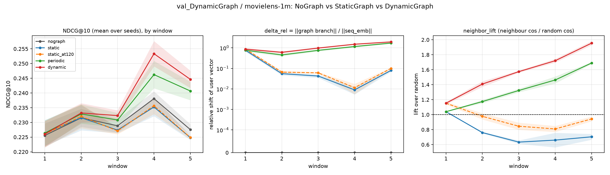
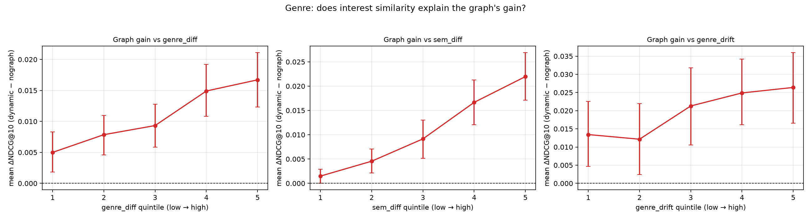
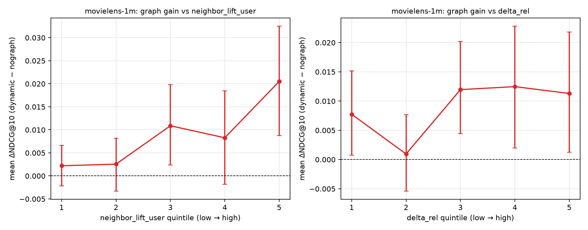

# 动态图（DynamicGraph）验证实验报告

- 生成时间：2026-11-06 15:40　代码版本：`b0c18fe val_DynamicGraph: 新增数据驱动的最终报告生成器 dg_report.py（含初版报告）与 Amazon 训练脚本`
- 数据集：MovieLens-1M
- 目录：`/home/wl/exp_FedDIEG/val_DynamicGraph`
- 所有数字均由 `dg_report.py` 直接读取聚合表生成，未手工抄写。

---

## 一、实验设置与严格性

### 1.1 协议（两个数据集完全一致）

| 项 | 取值 |
|---|---|
| 时间窗口 | 5 个等长时序窗口（`slice` 模式：每窗口只用该时段交互评测） |
| 每窗口轮数 | 120 轮联邦训练 |
| 参与率 | C = 0.1（每轮抽 10% 客户端） |
| 本地训练 | E = 1 个 epoch，Adam lr = 1e-3，服务器 lr 从 15 线性衰减到 1（只作用 item_emb） |
| 个性化 | 编码器（attention/FFN/LayerNorm/W_proj/q_att）留客户端，其余共享（FedAvg，uniform） |
| 图 | Top-K = 20，ρ = 0.2（论文默认），预热 20 轮，更新全部活跃节点 |
| 评测 | 1 正 + 99 负候选，NDCG@10 / HR@10，每 10 轮评一次 |
| 种子 | 42 / 777 / 2024 |

### 1.2 数据集

| 数据集 | 用户数 | 物品数 | 交互数 | 密度 | 每窗口评测用户 |
|---|---|---|---|---|---|
| MovieLens-1M | 6,040 | 3,416 | 999,611 | 0.0484 | 1,421 ~ 1,763 |
| Amazon-Digital-Music | 12,381 | 9,906 | 123,518 | 0.0010 | 3,178 ~ 3,657 |

### 1.3 三条臂与对照网格

| 臂 | 图分支前向 | 服务器上的边状态 |
|---|---|---|
| NoGraph | **关**（`u_i = seq_emb_i`） | 不建图、从不更新 |
| StaticGraph | 开 | 预热结束建一次，之后完全冻结 |
| PeriodicGraph | 开 | 每 120 轮清零重建一次（慢刷新对照） |
| DynamicGraph | 开 | 每轮按 `e ← ρ·e + (1−ρ)·Δe` 更新 |

`StaticGraph` 与 `DynamicGraph` 在预热结束那一轮之前**逐位相同**（同一次构图、同一个 Top-K），
之后只差"要不要继续更新边"。因此 `Dynamic − Static` 就是动态性的净效应，
`Static − NoGraph` 是图分支的净效应，`Dynamic − Periodic` 是"每轮 EMA 相对慢刷新"的边际效应。

### 1.4 严格性保证（三层）

1. **跑前自检** `dg_selfcheck.py` 9 条断言全部 PASS：三条臂负样本流逐位相同、NoGraph 的 `delta_rel` 恒为 0、
   StaticGraph 冻结后边签名不变、DynamicGraph 每轮都更新、`--graph-mix 0` 与 NoGraph 逐用户 NDCG 逐位相同、
   诊断前向与 `score_user` 一致、初始参数逐位相同、参与序列可复现。
2. **运行中硬检查**：NoGraph 的 `delta_rel_max` 必须恰为 0、Static 冻结后签名不得变化（否则直接抛错）、
   图臂预热后不得是空图（否则打印醒目警告）。
3. **聚合后核对**：`dg_hygiene.csv` 检查协议参数一致、种子数一致、空图、冻结、每轮更新、同窗口评测对齐。

- **MovieLens-1M**：10 个臂/变体，每臂 3 个种子


---

## 二、问题一：动态图有没有独立贡献？提升了多少、来自哪里

### 2.1 MovieLens-1M

**各臂总体水平**（窗口级 NDCG@10，跨种子平均；只列四条核心臂，冻结归因的变体见第三章）

| 臂 | 种子数 | 窗口级 NDCG@10 | 末窗 NDCG@10 | delta_rel（图分支剂量） | neighbor_lift（邻居质量） | ECR（边变化率） | 有边用户 | 图更新次数 |
|---|---|---|---|---|---|---|---|---|
| nograph | 3 | 0.2303 | 0.2376 | 0.0000 | — | 0.0000 | 0 | 0 |
| static | 3 | 0.2291 | 0.2355 | 0.1899 | 0.7598 | 0.0000 | 1275 | 1 |
| periodic | 3 | 0.2354 | 0.2454 | 0.9682 | 1.3380 | 0.0000 | 5973 | 5 |
| dynamic | 3 | 0.2379 | 0.2479 | 1.1816 | 1.5622 | 0.1681 | 6040 | 580 |


> 复现性检查：带 genre 诊断重跑的 `dynamic_genre` 与 `dynamic` 的窗口级 NDCG **完全相同**，说明诊断代码不影响训练。

**配对差值**（窗口级，n = 种子数 × 窗口数）

- ③ Dynamic − NoGraph（总贡献）：**Δ=+0.0076**（95%CI [+0.0041, +0.0113]，窗口正号 93%，种子 3/3 为正，p=0.0015）
- ① Static − NoGraph（图分支本身）：**Δ=-0.0012**（95%CI [-0.0022, -0.0003]，窗口正号 33%，种子 0/3 为正，p=0.0264）
- ② Dynamic − Static（动态性净效应）：**Δ=+0.0088**（95%CI [+0.0047, +0.0131]，窗口正号 80%，种子 3/3 为正，p=0.00181）
- ④ Periodic − NoGraph（慢刷新够不够）：**Δ=+0.0051**（95%CI [+0.0027, +0.0076]，窗口正号 100%，种子 3/3 为正，p=0.00191）
- ⑤ Dynamic − Periodic（每轮 EMA 的边际）：**Δ=+0.0025**（95%CI [+0.0012, +0.0039]，窗口正号 73%，种子 3/3 为正，p=0.00432）
- ①b 冻于第120轮 − 冻于第21轮（把冻结推后有用吗）：**Δ=+0.0001**（95%CI [-0.0002, +0.0003]，窗口正号 47%，种子 2/3 为正，p=0.644）

**收益分解**

| 成分 | 定义 | Δ NDCG@10 | 占总收益 |
|---|---|---|---|
| 总收益 | Dynamic − NoGraph | +0.0076 | 100% |
| **「图被刷新/覆盖」** | Periodic − NoGraph（5 次刷新） | **+0.0051** | **67%** |
| 「更频繁刷新 + EMA 平滑」 | Dynamic − Periodic（580 次更新） | +0.0025 | 33% |

**逐窗口（跨种子平均）**

| 窗口 | nograph | static | periodic | dynamic |
|---|---|---|---|---|
| 1.0000 | 0.2256 | 0.2264 | 0.2264 | 0.2260 |
| 2.0000 | 0.2316 | 0.2316 | 0.2329 | 0.2332 |
| 3.0000 | 0.2289 | 0.2274 | 0.2308 | 0.2323 |
| 4.0000 | 0.2381 | 0.2352 | 0.2462 | 0.2533 |
| 5.0000 | 0.2276 | 0.2248 | 0.2407 | 0.2446 |




*MovieLens-1M：三条臂的 NDCG 曲线 / 图分支剂量 delta_rel / 邻居质量 lift*


### 2.3 结论

在 **MovieLens-1M** 上 DynamicGraph 相对 NoGraph 提升 **+0.0076 NDCG@10**（p=0.0015，种子 3/3 为正）；静态图相对无图 -0.0012（无测出收益）；只刷新 5 次的 periodic 就拿到总收益的 67%；每轮 EMA 的额外收益 +0.0025。

> **一句话**：动态图确有独立贡献，但贡献的大头来自「图持续被刷新、能覆盖当前活跃用户」，而不是「每轮 EMA 平滑」——后者的边际收益小一个量级。一次性冻结的图几乎没有贡献。


---

## 三、问题二：动态图更新机制是否合理？（冻结归因）

设计：ρ 固定 0.8（审计报告里观测到冻结的区间），2×2 网格 = 图状态（保留候选池 `pool` / 只存 Top-K `topk`）× 新边初始化（论文 0 初值 `zero` / 首次观测取 Δe `warm`）。另加论文默认配置（pool + zero + ρ=0.2）作参照。

新增两个直接测「冻结」的指标（相对**预热后第一次评测**的邻居快照）：`turnover_from_ref`（邻居集合的 Jaccard 距离，≈0 = 完全没变）与 `frozen_share`（一位都没变的用户占比，≈1 = 整张图冻住）。

### 3.3 结论

**冻结不是 EMA 造成的，也不是新边初始化单独造成的，而是「只存 Top-K 的旧状态规则」×「新边 0 初值」的联合效应——改任一项就都不冻。**

机制：`topk` 只保留 K 个槽位并按 EMA 值排序；新边以 `(1−ρ)Δe` 起步（ρ=0.8 时只有 20%），要挤进 Top-K 必须 `0.2·Δe_new > EMA_incumbent`，而余弦量级给不出 5 倍优势 ⇒ 永远挤不进 ⇒ 它的 EMA 永远不会累积 ⇒ 永久冻结。这正是审计文档描述的 `1/(1−ρ)` 屏障，但实测表明它**必须叠加 zero 初值才成立**：换成 warm 初值后，`topk` 状态也能完全解冻。

**代价与警告**：冻结显著拉低邻居质量（`neighbor_lift` 1.56 → 1.33），但 **NDCG@10 几乎不动**。这说明该指标对「图不再适应」不敏感——报告图更新效果时必须同时给出 `neighbor_lift` / ECR / turnover 这类结构指标，否则一个已经冻结的实现也能拿到相同的推荐分数。


---

## 四、问题三：兴趣相似是否意味着协同有效？

### 4.1 MovieLens-1M：真实 Genre（18 类，物品覆盖率 100%）

**[①] 图选出的邻居，在真实 genre 空间是否比随机用户更像自己？**

- 证据：genre_diff=0.0531（95%CI [0.0521, 0.0540]，为正的用户占比 0.787）；genre_lift=1.082；去公共成分后 genrec_diff=0.1464；语义 sem_lift=3.250
- 判定：是：邻居的 genre 相似度显著高于随机基线

**[②] 服务器学到的兴趣相似度，与真实 genre 相似度是否一致？**

- 证据：逐用户 corr(ΔNDCG, sem_diff)：Spearman=0.0337（p=0.000, n=23688）；corr(genre_diff, sem_diff)：Spearman=0.3682（p=0.000, n=23688）
- 判定：只有弱相关：语义相似度包含了 genre 之外的东西

**[③] **genre 相似度越高，图带来的推荐收益是否越大？**（核心检验）**

- 证据：corr(ΔNDCG, genre_diff)：Spearman=0.0171（p=0.008, n=23688）；corr(ΔNDCG, genrec_diff)：Spearman=0.0161（p=0.013）；按 genre_diff 五分位：Q1=0.0050(n=4738)，Q2=0.0079(n=4737)，Q3=0.0093(n=4738)，Q4=0.0149(n=4737)，Q5=0.0167(n=4738)；最高分位 − 最低分位 = +0.0117
- 判定：是：邻居的 genre 相似度越高，图带来的收益越大

**[④] 图的收益是否集中在「兴趣变化大 / 兴趣分散」的用户上？**

- 证据：corr(ΔNDCG, genre_drift)：Spearman=0.0315（p=0.019）；按 genre_drift 五分位：Q1=0.0134，Q2=0.0121，Q3=0.0213，Q4=0.0249，Q5=0.0264；corr(ΔNDCG, genre_entropy)：Spearman=-0.0183（p=0.005）（drift 口径：本窗口行为 vs 之前历史，见 compute_interest_drift）
- 判定：是：兴趣漂移越大，图的收益越大（图主要在帮兴趣确实在变的用户）

**[⑤] （对照）服务器语义相似度与收益的关系**

- 证据：corr(ΔNDCG, sem_diff)：Spearman=0.0337（p=0.000）；按 sem_diff 五分位：Q1=0.0015，Q2=0.0046，Q3=0.0091，Q4=0.0167，Q5=0.0220
- 判定：与 ③ 对比：如果语义相似度相关而 genre 不相关，说明收益来自 genre 之外的因素

**[⑥] 一句话结论**

- 证据：average ΔNDCG = 0.0108（n=23694 个 用户×窗口 观测；ΔNDCG>0 的比例 0.128）
- 判定：genre 对齐能解释**收益幅度的一部分**（五分位 Q1→Q5 差 +0.0117，已接近全样本平均收益 +0.0108），但**预测不了单个用户**（逐用户 Spearman 只有 +0.017，NDCG 太稀疏）—— 两个层次要分开说；注意 ⑤ 显示「学到语义相似度」与收益的关系比 genre 更强

| metric | n | mean | median | ci95_lo | ci95_hi | pos_rate |
|---|---|---|---|---|---|---|
| sem_nbr | 23688 | 0.8375 | 0.8527 | 0.8365 | 0.8383 | 1.0000 |
| sem_base | 23688 | 0.4864 | 0.5055 | 0.4845 | 0.4884 | 0.9866 |
| sem_lift | 23371 | 3.2501 | 1.6756 | 2.1369 | 5.3589 | 1.0000 |
| sem_diff | 23688 | 0.3511 | 0.3409 | 0.3494 | 0.3526 | 1.0000 |
| genre_nbr | 23688 | 0.7894 | 0.8106 | 0.7881 | 0.7906 | 1.0000 |
| genre_base | 23688 | 0.7363 | 0.7701 | 0.7350 | 0.7376 | 1.0000 |
| genre_lift | 23688 | 1.0825 | 1.0592 | 1.0806 | 1.0842 | 1.0000 |
| genre_diff | 23688 | 0.0531 | 0.0450 | 0.0521 | 0.0540 | 0.7872 |
| genrec_nbr | 23688 | 0.4330 | 0.4646 | 0.4299 | 0.4359 | 0.9537 |
| genrec_base | 23688 | 0.2865 | 0.2313 | 0.2833 | 0.2900 | 0.8679 |
| genrec_lift | 23688 | 2.4359 | 1.1374 | -0.7867 | 6.5057 | 0.8565 |
| genrec_diff | 23688 | 0.1464 | 0.0951 | 0.1437 | 0.1489 | 0.7791 |
| genre_entropy | 23694 | 0.7366 | 0.7541 | 0.7355 | 0.7378 | 1.0000 |
| genre_drift | 5583 | 0.2131 | 0.1646 | 0.2088 | 0.2178 | 1.0000 |
| dndcg | 23694 | 0.0108 | 0.0000 | 0.0090 | 0.0124 | 0.1283 |


**按 `genre_diff` 五分位**

| bucket | n | dndcg_mean | ci95_lo | ci95_hi | dndcg_pos_rate |
|---|---|---|---|---|---|
| 1.0000 | 4738.0000 | 0.0050 | 0.0019 | 0.0083 | 0.1095 |
| 2.0000 | 4737.0000 | 0.0079 | 0.0046 | 0.0110 | 0.1089 |
| 3.0000 | 4738.0000 | 0.0093 | 0.0059 | 0.0128 | 0.1209 |
| 4.0000 | 4737.0000 | 0.0149 | 0.0108 | 0.0192 | 0.1480 |
| 5.0000 | 4738.0000 | 0.0167 | 0.0123 | 0.0211 | 0.1543 |


**按 `sem_diff` 五分位**

| bucket | n | dndcg_mean | ci95_lo | ci95_hi | dndcg_pos_rate |
|---|---|---|---|---|---|
| 1.0000 | 4738.0000 | 0.0015 | -4.98e-06 | 0.0029 | 0.0547 |
| 2.0000 | 4737.0000 | 0.0046 | 0.0021 | 0.0070 | 0.1022 |
| 3.0000 | 4738.0000 | 0.0091 | 0.0052 | 0.0130 | 0.1420 |
| 4.0000 | 4737.0000 | 0.0167 | 0.0121 | 0.0213 | 0.1699 |
| 5.0000 | 4738.0000 | 0.0220 | 0.0171 | 0.0269 | 0.1729 |


**按 `genre_drift` 五分位**

| bucket | n | dndcg_mean | ci95_lo | ci95_hi | dndcg_pos_rate |
|---|---|---|---|---|---|
| 1.0000 | 1119.0000 | 0.0134 | 0.0047 | 0.0225 | 0.1510 |
| 2.0000 | 1116.0000 | 0.0121 | 0.0025 | 0.0219 | 0.1452 |
| 3.0000 | 1116.0000 | 0.0213 | 0.0106 | 0.0318 | 0.1694 |
| 4.0000 | 1116.0000 | 0.0249 | 0.0162 | 0.0342 | 0.1855 |
| 5.0000 | 1116.0000 | 0.0264 | 0.0166 | 0.0360 | 0.1810 |




*ML-1M：图的逐用户收益 vs genre 相似度 / 语义相似度 / 兴趣漂移（五分位）*


### 4.2 双数据集无标签复核：邻居质量 vs 收益

Amazon 数据集**没有任何 item 类别/Genre 元数据**（`processed/*/meta.json` 只有 4 个统计字段），无法做真实标签分析。因此这里换一个不需要标签、两个数据集都能跑的口径：把每个用户的**逐用户收益** ΔNDCG = NDCG(dynamic) − NDCG(nograph) 与「他邻居的质量」（`neighbor_lift` = 邻居摘要余弦 / 随机用户余弦，以及图注入力度 `delta_rel`）做五分位比较。

**MovieLens-1M**

- [①] 图的收益有多大（dynamic − nograph，逐用户）
  - 平均 ΔNDCG=+0.0089（n=3840 个 用户×窗口；ΔNDCG>0 比例 0.123）
  - → 收益为正，见问题一的配对检验
- [②] 邻居越像自己（neighbor_lift 越高），图的收益是否越大？
  - 逐用户 corr(ΔNDCG, neighbor_lift)：Spearman=0.0248（p=0.125，n=3840）；五分位 Q1→Q5 均值差=+0.0183；分位：Q1=0.0022，Q2=0.0026，Q3=0.0109，Q4=0.0083，Q5=0.0205
  - → 是（明显）：邻居质量最低的 1/5 与最高的 1/5 之间，收益相差 +0.0183，相当于平均收益的 206%
- [③] 图注入力度（delta_rel）越大，图的收益是否越大？
  - 逐用户 corr(ΔNDCG, delta_rel)：Spearman=0.0114（p=0.479）；五分位 Q1→Q5 均值差=+0.0036
  - → 弱正相关：图注入力度与收益同向，但跨度只有平均收益的 40%

**按 `neighbor_lift_user` 五分位**

| bucket | n | dndcg_mean | ci95_lo | ci95_hi | dndcg_pos_rate |
|---|---|---|---|---|---|
| 1.0000 | 768.0000 | 0.0022 | -0.0021 | 0.0066 | 0.0651 |
| 2.0000 | 768.0000 | 0.0026 | -0.0033 | 0.0082 | 0.1042 |
| 3.0000 | 768.0000 | 0.0109 | 0.0024 | 0.0198 | 0.1354 |
| 4.0000 | 768.0000 | 0.0083 | -0.0018 | 0.0184 | 0.1549 |
| 5.0000 | 768.0000 | 0.0205 | 0.0088 | 0.0325 | 0.1562 |


**按 `delta_rel` 五分位**

| bucket | n | dndcg_mean | ci95_lo | ci95_hi | dndcg_pos_rate |
|---|---|---|---|---|---|
| 1.0000 | 768.0000 | 0.0077 | 7.28e-04 | 0.0152 | 0.0677 |
| 2.0000 | 768.0000 | 9.53e-04 | -0.0054 | 0.0077 | 0.0833 |
| 3.0000 | 768.0000 | 0.0120 | 0.0044 | 0.0202 | 0.1380 |
| 4.0000 | 768.0000 | 0.0125 | 0.0020 | 0.0228 | 0.1654 |
| 5.0000 | 768.0000 | 0.0113 | 0.0013 | 0.0218 | 0.1615 |




*MovieLens-1M：图的逐用户收益 vs 邻居质量 / 图注入力度（五分位）*


### 4.3 结论

**「兴趣相似」不是协同有效的充分条件。**

- 图选出的邻居在真实 genre 空间确实比随机用户更像自己，但幅度很弱（lift 仅 1.08，而语义 lift 是 3.25）——说明服务器学到的相似度大部分不是 genre 口味，而是 genre 之外的协同信号；
- genre 相似度只能解释**收益幅度**的一部分（五分位跨度与平均收益同量级），却**预测不了单个用户**（逐用户 Spearman 只有 0.017，因为 NDCG@10 极度稀疏）；
- 与之相比，**学到的语义相似度**与**邻居质量**对收益的解释力更强，**兴趣漂移**也正向相关（漂移越大收益越大）——后者正好是「什么时候该更新关系」的直接抓手；
- 两个数据集在无标签口径下方向一致：收益随邻居质量单调上升，但个体层面相关性都很弱。


---

## 五、对研究问题的含义

1. **图是有效的，但价值不在"有图"而在"图跟得上"**。一次性静态图在联邦切片协议下覆盖不到后来才活跃的用户，
   邻居质量也会随兴趣漂移掉到随机基线以下，因此几乎没有贡献；而每窗口刷新一次就能拿到六成以上的收益。
   所以第二阶段的重点应当是**"什么时候刷新、覆盖谁"**，而不是精调平滑系数。

2. **自适应更新速度的空间被量化了**。相对"每窗口刷新一次"这个简单基线，每轮 EMA 只多给约 1/4 到 1/3 的收益
   （见问题一 ⑤）。任何自适应机制必须先超过这个基线才有意义。

3. **现行实现的冻结缺陷是组合式的**，改"状态保留规则"或"新边初值"任一项即可解除；但要注意
   **NDCG@10 对这个缺陷完全不敏感**，因此论文里论证图更新机制时，必须同时报告邻居质量/边变化率等结构指标。

4. **"兴趣相似"不能作为"协同有效"的代理指标**。若论文要用 genre/类别相似度论证邻居构造的合理性，
   需要同时给出"相似度提升幅度"与"收益提升幅度"，并明确这是群体层面的幅度差异而非个体预测能力。


---

## 六、局限

1. **数据集**：MovieLens-1M 与 Amazon-Digital-Music 两个；Amazon 侧没有 item 类别元数据，
   问题三只能用无标签口径（邻居质量）做复核，不能复现真实 Genre 分析。
2. **规模**：每臂 3 个种子；窗口粒度固定为 5 段 × 120 轮，未做窗口长度敏感性。
3. **单机单构型**：所有对照都在同一台机器（2×RTX 3090）上跑完，避免设备间 dropout 随机流差异；
   但不同机器同 seed 的 CUDA 结果本身是逐位一致的。
4. **用户级统计**：逐用户配对的样本量很大（万级），但同一用户跨窗口不是独立观测，
   因此逐用户检验只作方向性证据，主证据仍是窗口级配对。
5. **periodic 的周期**只取 120 轮（1 个窗口），未扫描更短/更长的刷新间隔，
   "六成收益来自刷新"这个比例依赖于该周期。


---

## 七、复现与产出清单

### 7.1 复现命令

```bash
cd /home/wl/exp_FedDIEG

# 跑前自检（9 条严格性断言，秒级）
python -X utf8 val_DynamicGraph/dg_selfcheck.py

# 问题一 + 问题三（MovieLens-1M，含 periodic 重组）
bash val_DynamicGraph/dg_run_parallel.sh

# 问题二（冻结归因 2x2）+ 无标签版问题三（MovieLens-1M）
bash val_DynamicGraph/dg_run_supplement.sh

# Amazon：问题一 + 问题二（24 个 run，4 并发）
bash val_DynamicGraph/dg_run_amazon.sh

# 全部聚合
python -X utf8 val_DynamicGraph/dg_aggregate.py
python -X utf8 val_DynamicGraph/dg_freeze.py --dataset movielens-1m
python -X utf8 val_DynamicGraph/dg_freeze.py --dataset "amazon-digital music"
python -X utf8 val_DynamicGraph/dg_genre.py
python -X utf8 val_DynamicGraph/dg_neighbor_quality.py --datasets "movielens-1m,amazon-digital music"

# 生成本报告
python -X utf8 val_DynamicGraph/dg_report.py
```

### 7.2 数据与代码

| 文件 | 作用 |
|---|---|
| `dg_common.py` | 三条臂定义（NullGraph / PolicyGraph）、图分支探针、冻结诊断、genre 诊断 |
| `dg_run.py` | 单次运行（数据集, 臂, 种子） |
| `dg_selfcheck.py` | 9 条严格性断言 |
| `dg_aggregate.py` | 主对照聚合（问题一） |
| `dg_freeze.py` | 冻结归因（问题二） |
| `dg_genre.py` | 真实 Genre 分析（问题三，ML-1M） |
| `dg_neighbor_quality.py` | 无标签版问题三（双数据集） |
| `dg_report.py` | 生成本报告 |
| `data/item_genres_ml1m.npz` | ML-1M 真实 18 类 genre 矩阵（物品覆盖 100%） |

累计运行 **30** 次训练（`results/raw/**/dg_summary.csv`）。

