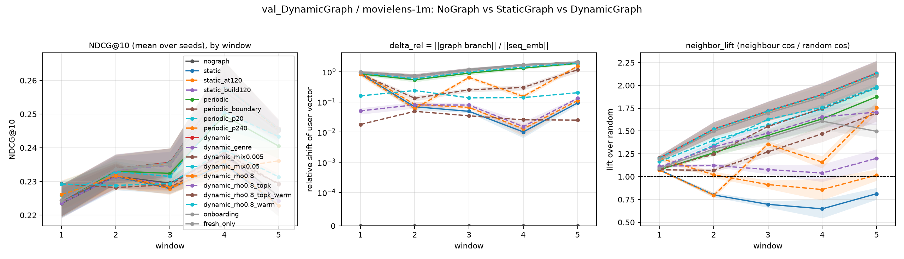
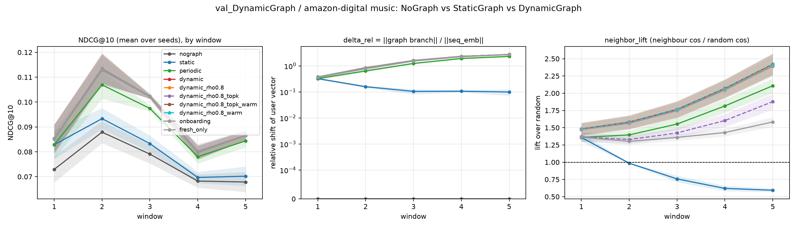
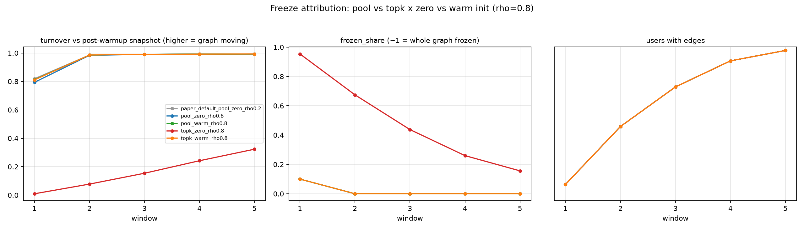
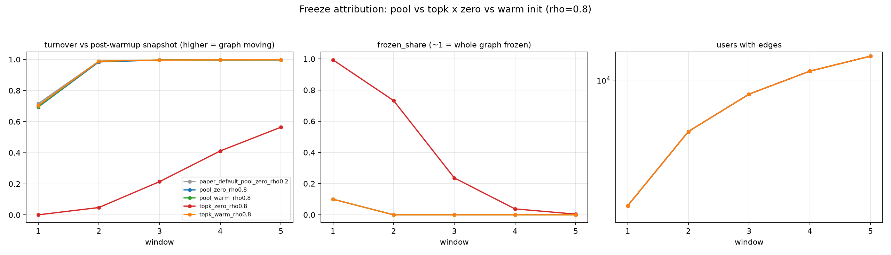
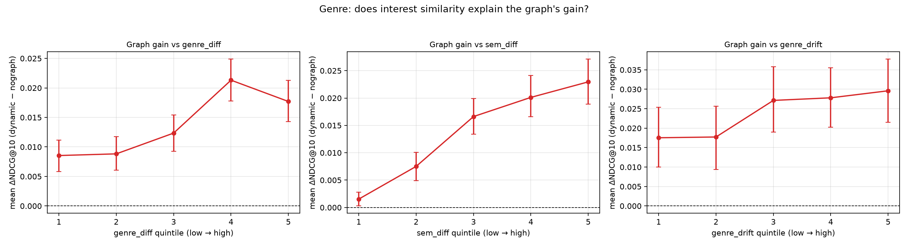
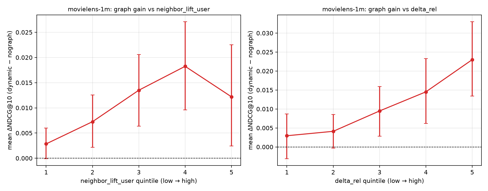
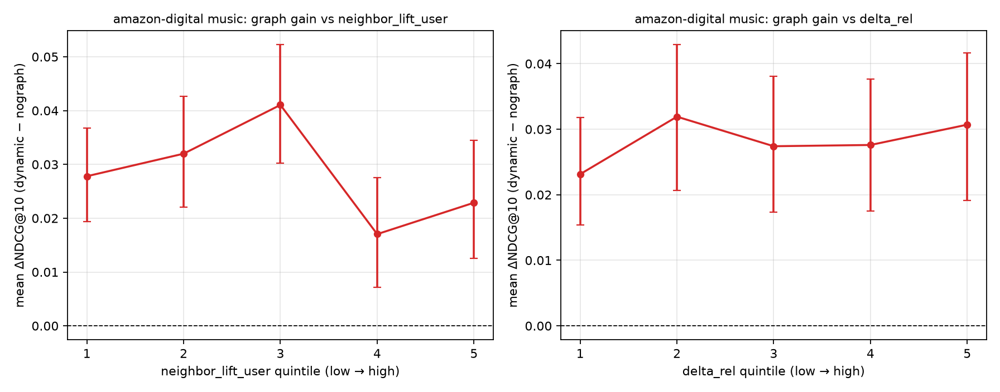

# 动态图（DynamicGraph）验证实验报告

- 生成时间：2026-11-11 23:24　代码版本：`eb14c21 val_DynamicGraph: 并行调度改为按自身负载选卡（避免崩溃重排后进程挤在一张卡上）`
- 数据集：MovieLens-1M、Amazon-Digital-Music
- 目录：`/home/wl/exp_FedDIEG/val_DynamicGraph`
- 所有数字均由 `dg_report.py` 直接读取聚合表生成，未手工抄写。

---

## 一、实验设置与严格性

> 本报告的全部数字来自 **修复后重训的正式批次**（`results/raw_formal`）：
> 摘要上传时机改为本地训练**之后**取（F7）、时间切分的排除集/回退候选/历史集合改为因果（F8）。
> 修复前的 `results/raw`、`results/raw_phase2(b)` 一律标为 legacy，**不与本表混比**。

### 1.1 协议（两个数据集完全一致）

| 项 | 取值 |
|---|---|
| 时间窗口 | 5 个等长时序窗口（`slice` 模式：每窗口只用该时段交互评测） |
| 每窗口轮数 | 120 轮联邦训练 |
| 参与率 | C = 0.1（每轮抽 10% 客户端） |
| 本地训练 | E = 1 个 epoch，Adam lr = 1e-3，服务器 lr 从 15 线性衰减到 1（只作用 item_emb） |
| 个性化 | 编码器（attention/FFN/LayerNorm/W_proj/q_att）留客户端，其余共享（FedAvg，uniform） |
| 图 | Top-K = 20，ρ = 0.2（论文默认），预热 20 轮，更新全部活跃节点 |
| 评测 | 1 正 + 99 负候选，NDCG@10 / HR@10，每 10 轮评一次 |
| 种子 | 42 / 777 / 1234 / 2024 / 3407（主臂 5 个；刷新频率扫描与锚点按需减少） |
| 统计口径 | **种子级**为主证据（每种子一个观测，n=5，t 分布 95%CI + 配对 t）；窗口级只作敏感性分析 |

### 1.2 数据集

| 数据集 | 用户数 | 物品数 | 交互数 | 密度 | 每窗口评测用户 |
|---|---|---|---|---|---|
| MovieLens-1M | 6,040 | 3,416 | 999,611 | 0.0484 | 1,421 ~ 1,763 |
| Amazon-Digital-Music | 12,381 | 9,906 | 123,518 | 0.0010 | 3,178 ~ 3,657 |

### 1.3 六条臂与对照网格

| 臂 | 图分支前向 | 服务器上的边状态 |
|---|---|---|
| NoGraph | **关**（`u_i = seq_emb_i`） | 不建图、从不更新 |
| StaticGraph | 开 | 预热结束建一次（第 21 轮），之后完全冻结 |
| PeriodicGraph | 开 | 每 120 轮清零重建一次（慢刷新对照） |
| DynamicGraph | 开 | 每轮按 `e ← ρ·e + (1−ρ)·Δe` 更新 |
| **OnboardingGraph** | 开 | **只给「当前还没有邻居」的用户建边**（每人恰好一次）→ 分离「覆盖」 |
| **FreshOnlyGraph** | 开 | **只给「自上次更新后有新上传」的用户重估**（同一用户可多次）→ 「有针对性」的演化 |

`StaticGraph` 与 `DynamicGraph` 在预热结束那一轮之前**逐位相同**（同一次构图、同一个 Top-K），
之后只差「要不要继续更新边」。因此 `Dynamic − Static` 就是动态性的净效应，
`Static − NoGraph` 是图分支的净效应，`Dynamic − Periodic` 是「每轮 EMA 相对慢刷新」的边际效应。

**三项分解**（这是本报告回答「收益来自哪里」的主要口径）：

    Dynamic − Static = (Onboarding − Static) + (Dynamic − Onboarding)
                       └── 覆盖（新用户首次获得邻居）──┘   └── 演化（已覆盖用户的边权重估）──┘

另有诊断变体（不参与主对照）：`static_at120`（更新到第 120 轮再冻结）、
`static_build120`（第 120 轮一次性建图后冻结）、`periodic_boundary`（窗口边界重建）、
`periodic_p20` / `periodic_p240`（刷新周期 20 / 240 轮）、`dynamic @ ρ=0.8` 的四格冻结网格、
`dynamic_mix0.005` / `dynamic_mix0.05`（图分支剂量锚点）。

### 1.4 严格性保证（三层）

1. **跑前自检** `dg_selfcheck.py` 9 条断言全部 PASS：三条臂负样本流逐位相同、NoGraph 的 `delta_rel` 恒为 0、
   StaticGraph 冻结后边签名不变、DynamicGraph 每轮都更新、`--graph-mix 0` 与 NoGraph 逐用户 NDCG 逐位相同、
   诊断前向与 `score_user` 一致、初始参数逐位相同、参与序列可复现。
2. **运行中硬检查**：NoGraph 的 `delta_rel_max` 必须恰为 0、Static 冻结后签名不得变化（否则直接抛错）、
   图臂预热后不得是空图（否则打印醒目警告）。
3. **聚合后核对** `dg_verify_formal.sh` 29 项全 PASS：run 数（128 = ML 78 + Amazon 50）、
   `ecr_def`/`core_version` 唯一、主臂 5 种子、`static_build120` 首次建图恰在第 120 轮、
   冻结后边变化为 0、`onboarding` 每人恰好建边一次、`fresh_only` 重复重估、
   `periodic_boundary` 恰 5 次刷新、`dg_hygiene.csv` 全通过、报告章节与图引用完整。

- **MovieLens-1M**：18 个臂/变体，主臂各 5 个种子
- **Amazon-Digital-Music**：10 个臂/变体，主臂各 5 个种子


---

## 二、问题一：动态图有没有独立贡献？提升了多少、来自哪里

### 2.1 MovieLens-1M

**各臂总体水平**（窗口级 NDCG@10，跨种子平均；六条核心臂，诊断变体见本章末尾的诊断表与第三章）

| 臂 | 种子数 | 窗口级 NDCG@10 | 末窗 NDCG@10 | delta_rel（图分支剂量） | neighbor_lift（邻居质量） | 有边用户 | 图更新次数 | ECR（更新轮均值，v2 定义） | 图变化率 graph_turnover | 本窗口评测覆盖率 |
|---|---|---|---|---|---|---|---|---|---|---|
| nograph | 5 | 0.2297 | 0.2374 | 0.0000 | — | 0 | 0 | — | — | — |
| static | 5 | 0.2284 | 0.2346 | 0.2140 | 0.8066 | 1280 | 1 | 1 | 1 | 0.2142 |
| periodic | 5 | 0.2360 | 0.2466 | 1.0977 | 1.4600 | 5977 | 5 | 1 | 0.9591 | 0.7985 |
| dynamic | 5 | 0.2396 | 0.2506 | 1.3261 | 1.6959 | 6040 | 580 | 0.1334 | 0.1334 | 0.9399 |
| onboarding | 5 | 0.2389 | 0.2492 | 1.3271 | 1.3856 | 6040 | 240 | 1 | 1.0000 | 0.9399 |
| fresh_only | 5 | 0.2396 | 0.2508 | 1.3247 | 1.6730 | 6040 | 580 | 0.4674 | 0.4674 | 0.9399 |


> 复现性检查：带 genre 诊断重跑的 `dynamic_genre` 与 `dynamic` 的窗口级 NDCG **完全相同**，说明诊断代码不影响训练。

**配对差值**（**种子级为主证据**；窗口级只作敏感性分析）

- ③ Dynamic − NoGraph（总贡献）：**Δ=+0.0099**（种子级 95%CI [+0.0067, +0.0130]，种子 5/5 为正，p=0.000963）；窗口级敏感性：Δ=+0.0099，p=1.84e-05（n=25 个 种子×窗口 观测）
- ① Static − NoGraph（图分支本身）：**Δ=-0.0013**（种子级 95%CI [-0.0024, -0.0003]，种子 0/5 为正，p=0.0243）；窗口级敏感性：Δ=-0.0013，p=0.00564（n=25 个 种子×窗口 观测）
- ② Dynamic − Static（动态性净效应）：**Δ=+0.0112**（种子级 95%CI [+0.0082, +0.0142]，种子 5/5 为正，p=0.000485）；窗口级敏感性：Δ=+0.0112，p=1.92e-05（n=25 个 种子×窗口 观测）
- ④ Periodic − NoGraph（慢刷新够不够）：**Δ=+0.0063**（种子级 95%CI [+0.0041, +0.0085]，种子 5/5 为正，p=0.00141）；窗口级敏感性：Δ=+0.0063，p=4.86e-05（n=25 个 种子×窗口 观测）
- ⑤ Dynamic − Periodic（每轮 EMA 的边际）：**Δ=+0.0036**（种子级 95%CI [+0.0019, +0.0053]，种子 5/5 为正，p=0.00389）；窗口级敏感性：Δ=+0.0036，p=6.05e-05（n=25 个 种子×窗口 观测）
- ①b 「更新到 120 轮再冻结」− 冻于第 21 轮（晚冻结有用吗）：**Δ=+0.0001**（种子级 95%CI [-0.0001, +0.0004]，种子 3/5 为正，p=0.237）；窗口级敏感性：Δ=+0.0001，p=0.209（n=25 个 种子×窗口 观测）
- ①b2 「第 120 轮一次性建图」− 冻于第 21 轮（晚建图有用吗；只看 W2–W5）：**Δ=+0.0009**（种子级 95%CI [+0.0001, +0.0018]，种子 4/5 为正，p=0.0413）；窗口级敏感性：Δ=+0.0009，p=0.0197（n=25 个 种子×窗口 观测）

**策略臂：收益来自覆盖还是演化**

- 覆盖项 Onboarding − Static（晚出现用户首次拿到邻居）：**Δ=+0.0106**（种子级 95%CI [+0.0083, +0.0128]，种子 5/5 为正，p=0.000205）；窗口级敏感性：Δ=+0.0106，p=1.89e-05（n=25 个 种子×窗口 观测）
- 演化项 Dynamic − Onboarding（覆盖相同时，边权持续重估）：**Δ=+0.0007**（种子级 95%CI [-0.0002, +0.0016]，种子 5/5 为正，p=0.0985）；窗口级敏感性：Δ=+0.0007，p=0.0148（n=25 个 种子×窗口 观测）
- 针对性 FreshOnly − Static（只更新有新证据的用户）：**Δ=+0.0113**（种子级 95%CI [+0.0084, +0.0142]，种子 5/5 为正，p=0.00042）；窗口级敏感性：Δ=+0.0113，p=1.89e-05（n=25 个 种子×窗口 观测）
- DynamicGraph − FreshOnlyGraph（无差别 EMA 相对「只更新有新证据的人」）：**Δ=-0.0000**（种子级 95%CI [-0.0002, +0.0002]，种子 2/5 为正，p=0.654）；窗口级敏感性：Δ=-0.0000，p=0.648（n=25 个 种子×窗口 观测）

**三项分解**（② = 覆盖 + 演化，所有数取自 `dg_stats_decomp.csv`）

| 成分 | 对照 | Δ NDCG@10 | 占 ② |
|---|---|---|---|
| ② 动态性净效应 | Dynamic − Static | **+0.0112** | 100% |
| **覆盖项** | Onboarding − Static | **+0.0106** | **94%** |
| 演化项 | Dynamic − Onboarding | +0.0007 | 6% |
| 恒等残差 | ② − (覆盖+演化) | +1.7e-18 | — |

> 覆盖项只由「第 21 轮之后才第一次获得邻居的用户」贡献，所以它衡量的是**覆盖（含覆盖时点）**，不是「有没有边」的二元效应。


**诊断：刷新频率 × 覆盖时点（MovieLens-1M）**

| 臂 | 每次运行刷新次数 | active_coverage | graph_turnover | neighbor_lift | 窗口级 NDCG@10 | Δ vs periodic（种子级） | p |
|---|---|---|---|---|---|---|---|
| periodic | 5 | 0.7985 | 0.9591 | 1.4600 | 0.2360 | — | — |
| periodic_boundary | 5 | 0.4291 | 0.9586 | 1.3171 | 0.2302 | -0.0058 | 3.16e-04 |
| periodic_p20 | 29 | 0.8640 | 0.6961 | 1.5687 | 0.2368 | 0.0013 | 0.0989 |
| periodic_p240 | 3 | 0.5283 | 0.9888 | 1.2279 | 0.2312 | -0.0044 | 0.0233 |


> 刷新越靠近窗口起点（`periodic` 在每窗第 21 轮、`periodic_boundary` 在窗口边界），新窗口的用户越晚被覆盖；`active_coverage` 就是这件事的直接读数。

**诊断：什么时候建图（MovieLens-1M）**

| 臂 | 有边用户 | active_coverage | neighbor_lift | 窗口级 NDCG@10 | Δ vs static（种子级） | p |
|---|---|---|---|---|---|---|
| static | 1280 | 0.2142 | 0.8066 | 0.2284 | — | — |
| static_at120 | 1429 | 0.2391 | 1.0030 | 0.2285 | 1.48e-04 | 0.2369 |
| static_build120 | 1429 | 0.0902 | 1.1114 | 0.2293 | 9.29e-04 | 0.0413 |


> `static` 在第 21 轮建图后立即冻结（只覆盖 W1 那批用户）；`static_at120` 更新到第 120 轮再冻结；`static_build120` 第 120 轮一次性建图后冻结。

**锚点：图分支剂量（D1 口径可比性，MovieLens-1M）**

| 臂（后缀即 graph_mix） | delta_rel（图分支剂量） | 窗口级 NDCG@10 | 种子数 |
|---|---|---|---|
| dynamic | 1.3261 | 0.2396 | 5 |
| dynamic_mix0.05 | 0.1749 | 0.2316 | 1 |
| dynamic_mix0.005 | 0.0304 | 0.2309 | 1 |


> 这三条只差图分支注入强度：`graph_mix=1` 是主对照，0.05 / 0.005 用来对齐中期报告的口径（剂量越小，`delta_rel` 越小）。

**逐窗口（跨种子平均）**

| 窗口 | nograph | static | periodic | dynamic |
|---|---|---|---|---|
| 1 | 0.2235 | 0.2243 | 0.2243 | 0.2243 |
| 2 | 0.2315 | 0.2315 | 0.2331 | 0.2337 |
| 3 | 0.2295 | 0.2279 | 0.2324 | 0.2357 |
| 4 | 0.2383 | 0.2352 | 0.2496 | 0.2584 |
| 5 | 0.2256 | 0.2229 | 0.2405 | 0.2458 |




*MovieLens-1M：六条臂的 NDCG 曲线 / 图分支剂量 delta_rel / 邻居质量 lift*


### 2.2 Amazon-Digital-Music

**各臂总体水平**（窗口级 NDCG@10，跨种子平均；六条核心臂，诊断变体见本章末尾的诊断表与第三章）

| 臂 | 种子数 | 窗口级 NDCG@10 | 末窗 NDCG@10 | delta_rel（图分支剂量） | neighbor_lift（邻居质量） | 有边用户 | 图更新次数 | ECR（更新轮均值，v2 定义） | 图变化率 graph_turnover | 本窗口评测覆盖率 |
|---|---|---|---|---|---|---|---|---|---|---|
| nograph | 5 | 0.0752 | 0.0836 | 0.0000 | — | 0 | 0 | — | — | — |
| static | 5 | 0.0799 | 0.0917 | 0.1584 | 0.8633 | 2914 | 1 | 1 | 1 | 0.2348 |
| periodic | 5 | 0.0899 | 0.1055 | 1.2859 | 1.6465 | 12212 | 5 | 1 | 0.9698 | 0.7642 |
| dynamic | 5 | 0.0935 | 0.1092 | 1.5727 | 1.8640 | 12381 | 580 | 0.1183 | 0.1183 | 0.8695 |
| onboarding | 5 | 0.0934 | 0.1090 | 1.5466 | 1.4077 | 12381 | 277 | 1 | 1.0000 | 0.8695 |
| fresh_only | 5 | 0.0934 | 0.1091 | 1.5624 | 1.8442 | 12381 | 580 | 0.4354 | 0.4354 | 0.8695 |


**配对差值**（**种子级为主证据**；窗口级只作敏感性分析）

- ③ Dynamic − NoGraph（总贡献）：**Δ=+0.0183**（种子级 95%CI [+0.0161, +0.0205]，种子 5/5 为正，p=2.12e-05）；窗口级敏感性：Δ=+0.0183，p=1.82e-13（n=25 个 种子×窗口 观测）
- ① Static − NoGraph（图分支本身）：**Δ=+0.0047**（种子级 95%CI [+0.0037, +0.0056]，种子 5/5 为正，p=0.000187）；窗口级敏感性：Δ=+0.0047，p=2.03e-07（n=25 个 种子×窗口 观测）
- ② Dynamic − Static（动态性净效应）：**Δ=+0.0136**（种子级 95%CI [+0.0123, +0.0149]，种子 5/5 为正，p=8.11e-06）；窗口级敏感性：Δ=+0.0136，p=8.9e-10（n=25 个 种子×窗口 观测）
- ④ Periodic − NoGraph（慢刷新够不够）：**Δ=+0.0147**（种子级 95%CI [+0.0130, +0.0164]，种子 5/5 为正，p=1.71e-05）；窗口级敏感性：Δ=+0.0147，p=2.4e-14（n=25 个 种子×窗口 观测）
- ⑤ Dynamic − Periodic（每轮 EMA 的边际）：**Δ=+0.0035**（种子级 95%CI [+0.0029, +0.0042]，种子 5/5 为正，p=9.83e-05）；窗口级敏感性：Δ=+0.0035，p=4.87e-09（n=25 个 种子×窗口 观测）

**策略臂：收益来自覆盖还是演化**

- 覆盖项 Onboarding − Static（晚出现用户首次拿到邻居）：**Δ=+0.0135**（种子级 95%CI [+0.0118, +0.0152]，种子 5/5 为正，p=2.33e-05）；窗口级敏感性：Δ=+0.0135，p=1.07e-09（n=25 个 种子×窗口 观测）
- 演化项 Dynamic − Onboarding（覆盖相同时，边权持续重估）：**Δ=+0.0001**（种子级 95%CI [-0.0003, +0.0005]，种子 2/5 为正，p=0.57）；窗口级敏感性：Δ=+0.0001，p=0.486（n=25 个 种子×窗口 观测）
- 针对性 FreshOnly − Static（只更新有新证据的用户）：**Δ=+0.0135**（种子级 95%CI [+0.0123, +0.0148]，种子 5/5 为正，p=8.17e-06）；窗口级敏感性：Δ=+0.0135，p=9.8e-10（n=25 个 种子×窗口 观测）
- DynamicGraph − FreshOnlyGraph（无差别 EMA 相对「只更新有新证据的人」）：**Δ=+0.0000**（种子级 95%CI [-0.0000, +0.0001]，种子 3/5 为正，p=0.11）；窗口级敏感性：Δ=+0.0000，p=0.117（n=25 个 种子×窗口 观测）

**三项分解**（② = 覆盖 + 演化，所有数取自 `dg_stats_decomp.csv`）

| 成分 | 对照 | Δ NDCG@10 | 占 ② |
|---|---|---|---|
| ② 动态性净效应 | Dynamic − Static | **+0.0136** | 100% |
| **覆盖项** | Onboarding − Static | **+0.0135** | **99%** |
| 演化项 | Dynamic − Onboarding | +0.0001 | 1% |
| 恒等残差 | ② − (覆盖+演化) | -3.5e-18 | — |

> 覆盖项只由「第 21 轮之后才第一次获得邻居的用户」贡献，所以它衡量的是**覆盖（含覆盖时点）**，不是「有没有边」的二元效应。


**逐窗口（跨种子平均）**

| 窗口 | nograph | static | periodic | dynamic |
|---|---|---|---|---|
| 1 | 0.0729 | 0.0829 | 0.0829 | 0.0853 |
| 2 | 0.0879 | 0.0933 | 0.1069 | 0.1135 |
| 3 | 0.0791 | 0.0833 | 0.0974 | 0.1023 |
| 4 | 0.0683 | 0.0697 | 0.0781 | 0.0797 |
| 5 | 0.0679 | 0.0702 | 0.0844 | 0.0866 |




*Amazon-Digital-Music：六条臂的 NDCG 曲线 / 图分支剂量 delta_rel / 邻居质量 lift*


### 2.3 跨数据集对比

同一个结论在两个数据集上是否都成立（**全部为种子级 Δ**）：

| 数据集 | NoGraph | Static | Periodic | Dynamic | ③Δ | ③相对增幅 % | ③p | ①Δ（静态） | ②Δ（动态性） | 覆盖项 Δ | 覆盖占 ② % | 演化项 Δ | ⑤每轮 EMA 边际 |
|---|---|---|---|---|---|---|---|---|---|---|---|---|---|
| MovieLens-1M | 0.2297 | 0.2284 | 0.2360 | 0.2396 | 0.0099 | 4.3059 | 9.63e-04 | -0.0013 | 0.0112 | 0.0106 | 93.9428 | 6.80e-04 | 0.0036 |
| Amazon-Digital-Music | 0.0752 | 0.0799 | 0.0899 | 0.0935 | 0.0183 | 24.2764 | 2.12e-05 | 0.0047 | 0.0136 | 0.0135 | 99.3031 | 9.48e-05 | 0.0035 |


> 读法：③ 是动态图相对无图的总收益；② 是动态性净效应，它几乎全部由「覆盖项」解释（新用户第一次拿到邻居），「演化项」只占个位数百分比；⑤ 是「每轮 EMA」相对慢刷新的额外边际。


### 2.4 结论

在 **MovieLens-1M** 上 DynamicGraph 相对 NoGraph 提升 **+0.0099 NDCG@10**（种子级 p=0.000963，5/5 个种子为正）；静态图相对无图 -0.0013（无测出收益）；而这 +0.0112 的动态性净效应里，覆盖项占 +0.0106（94%）、演化项只有 +0.0007；「每轮 EMA」相对慢刷新的额外边际 +0.0036。
在 **Amazon-Digital-Music** 上 DynamicGraph 相对 NoGraph 提升 **+0.0183 NDCG@10**（种子级 p=2.12e-05，5/5 个种子为正）；静态图相对无图 +0.0047（有正收益）；而这 +0.0136 的动态性净效应里，覆盖项占 +0.0135（99%）、演化项只有 +0.0001；「每轮 EMA」相对慢刷新的额外边际 +0.0035。

> **一句话**：动态图在 MovieLens-1M、Amazon-Digital-Music 上有明确独立贡献；而 ② 的收益几乎全部来自**覆盖**——新窗口里的用户第一次拿到邻居：MovieLens-1M +0.0106（占 ② 的 94%）、Amazon-Digital-Music +0.0135（占 ② 的 99%）；已覆盖用户的边权持续重估（演化）只贡献 MovieLens-1M +0.0007（6%）、Amazon-Digital-Music +0.0001（1%）；一次性冻结的图相对无图 MovieLens-1M -0.0013（neighbor_lift 低于随机基线）、Amazon-Digital-Music +0.0047（neighbor_lift 略高于随机基线），它的收益（或损失）不能归因于邻居质量；「每轮 EMA」相对慢刷新（periodic）的额外边际只有 +0.0035~+0.0036。


---

## 三、问题二：动态图更新机制是否合理？（冻结归因）

设计：ρ 固定 0.8（审计报告里观测到冻结的区间），2×2 网格 = 图状态（保留候选池 `pool` / 只存 Top-K `topk`）× 新边初始化（论文 0 初值 `zero` / 首次观测取 Δe `warm`）。另加论文默认配置（pool + zero + ρ=0.2）作参照。

新增两个直接测「冻结」的指标（相对**预热后第一次评测**的邻居快照）：`turnover_from_ref`（邻居集合的 Jaccard 距离，≈0 = 完全没变）与 `frozen_share`（一位都没变的用户占比，≈1 = 整张图冻住）。

### 3.1 MovieLens-1M

| 格子 | 图状态 | 新边初始化 | ρ | 种子数 | turnover（越大越活） | frozen_share（≈1 冻住） | ECR | 新边/轮 | 有边用户 | neighbor_lift | 窗口级 NDCG@10 |
|---|---|---|---|---|---|---|---|---|---|---|---|
| paper_default_pool_zero_rho0.2 | pool | zero | 0.2000 | 5 | 0.9562 | 0.0200 | 0.1238 | 1.4372 | 6040 | 1.6959 | 0.2396 |
| pool_zero_rho0.8 | pool | zero | 0.8000 | 5 | 0.9507 | 0.0200 | 0.0838 | 0.9234 | 6040 | 1.6902 | 0.2395 |
| pool_warm_rho0.8 | pool | warm | 0.8000 | 5 | 0.9550 | 0.0200 | 0.0924 | 1.0327 | 6040 | 1.6931 | 0.2396 |
| topk_zero_rho0.8 | topk | zero | 0.8000 | 5 | 0.1614 | 0.4964 | 0.0022 | 0.0369 | 6040 | 1.4549 | 0.2389 |
| topk_warm_rho0.8 | topk | warm | 0.8000 | 5 | 0.9545 | 0.0200 | 0.1002 | 1.1420 | 6040 | 1.6944 | 0.2396 |


**[①] 四种配置下图到底冻没冻住（ρ=0.8）**

- 证据：pool+zero: frozen_share=0.020, turnover=0.951, ECR=0.0838, 新边=0.92；pool+warm: frozen_share=0.020, turnover=0.955, ECR=0.0924, 新边=1.03；topk+zero: frozen_share=0.496, turnover=0.161, ECR=0.0022, 新边=0.04；topk+warm: frozen_share=0.020, turnover=0.955, ECR=0.1002, 新边=1.14
- 判定：frozen_share 越接近 1、turnover 越接近 0 就越冻

**[②] 冻结的根因：EMA / 新边初始化 / 状态保留规则**

- 证据：pool+zero=不冻，pool+warm=不冻，topk+zero=冻，topk+warm=不冻
- 判定：冻结**只出现在 topk + zero 这一个组合**：pool 的两格都不冻（ρ=0.8 也一样），topk+warm 也不冻。所以它既不是 EMA 强度单独造成的，也不是任一单独因素造成的，而是**「只存 Top-K 的旧状态规则」×「新边 0 初值」的联合效应**：topk 状态会丢弃掉出 Top-K 的边历史，而 zero 初值让新边只能以 (1-ρ)Δe 起步（ρ=0.8 时仅 20%），根本挤不进 Top-K；挤不进 ⇒ EMA 永不累积 ⇒ 永久冻结。把任一项改掉（pool 或 warm）就都不冻。

**[③] 换 warm 初始化能不能解开冻结（topk 状态下）**

- 证据：Δfrozen_share=-0.476 [-0.579, -0.373]，p=5.04e-09
- 判定：warm 初始化**几乎完全解开**了冻结：topk+warm 的 frozen_share 只剩 0.020，已与 pool 两格同量级

**[④] 候选池下，warm 初始化让图转得快多少**

- 证据：Δturnover=+0.0042（p=0.00952）；Δ新边=+0.11（p=7.65e-11）；ΔNDCG=+0.0001（p=0.0716）
- 判定：初始化规则对适应速度几乎没有影响

**[⑤] ρ 从 0.2 提到 0.8（同为 pool+zero）改变了什么**

- 证据：Δturnover=-0.0055（p=0.013）；ΔNDCG=-0.0001（p=0.0695）
- 判定：ρ 对 turnover 没有明显影响

**[⑥] 各配置的推荐效果（窗口级 NDCG@10）**

- 证据：pool+zero ρ0.8: 0.2395；pool+warm ρ0.8: 0.2396；topk+zero ρ0.8: 0.2389；topk+warm ρ0.8: 0.2396；论文默认 pool+zero ρ0.2: 0.2396
- 判定：冻结的图不仅不涨，还会因为邻居失真而略微拖低（见体检列）

**[⑥b] 冻结的代价：邻居质量与推荐指标**

- 证据：neighbor_lift：pool+zero=1.690 → topk+zero=1.455（-0.235）；窗口级 NDCG@10：0.2395 → 0.2389（-0.0006）
- 判定：冻结把邻居质量明显拉低，但 NDCG@10 几乎没变 —— 说明这个指标对「图不再适应」不敏感，评测时不能只看 NDCG，必须同时看 neighbor_lift / ECR 这类结构指标

**[⑦] 一句话结论**

- 证据：冻结 = 「只存 Top-K」×「新边 0 初值」的联合效应，改任一项即可解除；topk 下改用 warm 初值可把冻结用户占比降 0.48（p=5e-09）；候选池下 warm 相对 zero 只多转 +0.004（几乎无差别）
- 判定：回答「更新机制是否合理」：现行实现的隐患是**旧状态规则 + 论文 0 初值的组合会让图永久冻结**；而冻结的代价主要落在邻居质量（lift 下降），NDCG@10 看不出来



*MovieLens-1M：turnover / frozen_share / 有边用户数*


### 3.2 Amazon-Digital-Music

| 格子 | 图状态 | 新边初始化 | ρ | 种子数 | turnover（越大越活） | frozen_share（≈1 冻住） | ECR | 新边/轮 | 有边用户 | neighbor_lift | 窗口级 NDCG@10 |
|---|---|---|---|---|---|---|---|---|---|---|---|
| paper_default_pool_zero_rho0.2 | pool | zero | 0.2000 | 5 | 0.9389 | 0.0200 | 0.1083 | 1.2412 | 12381 | 1.8640 | 0.0935 |
| pool_zero_rho0.8 | pool | zero | 0.8000 | 5 | 0.9335 | 0.0200 | 0.0726 | 0.7935 | 12381 | 1.8579 | 0.0935 |
| pool_warm_rho0.8 | pool | warm | 0.8000 | 5 | 0.9352 | 0.0200 | 0.0761 | 0.8371 | 12381 | 1.8620 | 0.0935 |
| topk_zero_rho0.8 | topk | zero | 0.8000 | 5 | 0.2477 | 0.4011 | 0.0026 | 0.0396 | 12381 | 1.5208 | 0.0934 |
| topk_warm_rho0.8 | topk | warm | 0.8000 | 5 | 0.9366 | 0.0200 | 0.0831 | 0.9314 | 12381 | 1.8626 | 0.0935 |


**[①] 四种配置下图到底冻没冻住（ρ=0.8）**

- 证据：pool+zero: frozen_share=0.020, turnover=0.934, ECR=0.0726, 新边=0.79；pool+warm: frozen_share=0.020, turnover=0.935, ECR=0.0761, 新边=0.84；topk+zero: frozen_share=0.401, turnover=0.248, ECR=0.0026, 新边=0.04；topk+warm: frozen_share=0.020, turnover=0.937, ECR=0.0831, 新边=0.93
- 判定：frozen_share 越接近 1、turnover 越接近 0 就越冻

**[②] 冻结的根因：EMA / 新边初始化 / 状态保留规则**

- 证据：pool+zero=不冻，pool+warm=不冻，topk+zero=冻，topk+warm=不冻
- 判定：冻结**只出现在 topk + zero 这一个组合**：pool 的两格都不冻（ρ=0.8 也一样），topk+warm 也不冻。所以它既不是 EMA 强度单独造成的，也不是任一单独因素造成的，而是**「只存 Top-K 的旧状态规则」×「新边 0 初值」的联合效应**：topk 状态会丢弃掉出 Top-K 的边历史，而 zero 初值让新边只能以 (1-ρ)Δe 起步（ρ=0.8 时仅 20%），根本挤不进 Top-K；挤不进 ⇒ EMA 永不累积 ⇒ 永久冻结。把任一项改掉（pool 或 warm）就都不冻。

**[③] 换 warm 初始化能不能解开冻结（topk 状态下）**

- 证据：Δfrozen_share=-0.381 [-0.530, -0.236]，p=3.66e-05
- 判定：warm 初始化**几乎完全解开**了冻结：topk+warm 的 frozen_share 只剩 0.020，已与 pool 两格同量级

**[④] 候选池下，warm 初始化让图转得快多少**

- 证据：Δturnover=+0.0016（p=0.000329）；Δ新边=+0.04（p=2.33e-11）；ΔNDCG=-0.0000（p=0.414）
- 判定：初始化规则对适应速度几乎没有影响

**[⑤] ρ 从 0.2 提到 0.8（同为 pool+zero）改变了什么**

- 证据：Δturnover=-0.0054（p=0.00514）；ΔNDCG=+0.0000（p=0.259）
- 判定：ρ 对 turnover 没有明显影响

**[⑥] 各配置的推荐效果（窗口级 NDCG@10）**

- 证据：pool+zero ρ0.8: 0.0935；pool+warm ρ0.8: 0.0935；topk+zero ρ0.8: 0.0934；topk+warm ρ0.8: 0.0935；论文默认 pool+zero ρ0.2: 0.0935
- 判定：冻结的图不仅不涨，还会因为邻居失真而略微拖低（见体检列）

**[⑥b] 冻结的代价：邻居质量与推荐指标**

- 证据：neighbor_lift：pool+zero=1.858 → topk+zero=1.521（-0.337）；窗口级 NDCG@10：0.0935 → 0.0934（-0.0001）
- 判定：冻结把邻居质量明显拉低，但 NDCG@10 几乎没变 —— 说明这个指标对「图不再适应」不敏感，评测时不能只看 NDCG，必须同时看 neighbor_lift / ECR 这类结构指标

**[⑦] 一句话结论**

- 证据：冻结 = 「只存 Top-K」×「新边 0 初值」的联合效应，改任一项即可解除；topk 下改用 warm 初值可把冻结用户占比降 0.38（p=3.7e-05）；候选池下 warm 相对 zero 只多转 +0.002（几乎无差别）
- 判定：回答「更新机制是否合理」：现行实现的隐患是**旧状态规则 + 论文 0 初值的组合会让图永久冻结**；而冻结的代价主要落在邻居质量（lift 下降），NDCG@10 看不出来



*Amazon-Digital-Music：turnover / frozen_share / 有边用户数*


### 3.3 结论

**冻结的归属（逐数据集实测）**

- **MovieLens-1M**（pool+zero=不冻、pool+warm=不冻、topk+zero=冻、topk+warm=不冻）：冻结只出现在 `topk + zero` 一个组合，换成 pool 或 warm 任一项即解除 ⇒ **「只存 Top-K 的状态规则」×「新边 0 初值」的联合效应**，既不是 EMA 强度、也不是初始化规则单独造成。
- **Amazon-Digital-Music**（pool+zero=不冻、pool+warm=不冻、topk+zero=冻、topk+warm=不冻）：冻结只出现在 `topk + zero` 一个组合，换成 pool 或 warm 任一项即解除 ⇒ **「只存 Top-K 的状态规则」×「新边 0 初值」的联合效应**，既不是 EMA 强度、也不是初始化规则单独造成。

机制：`topk` 只保留 K 个槽位并按 EMA 值排序；新边以 `(1−ρ)Δe` 起步（ρ=0.8 时只有初始相似度的 20%），要挤进 Top-K 必须 `0.2·Δe_new > EMA_incumbent`，而余弦量级给不出 5 倍优势 ⇒ 永远挤不进 ⇒ 它的 EMA 永远不会累积 ⇒ 永久冻结。这正是审计文档描述的 `1/(1−ρ)` 屏障。

**代价：邻居质量 vs 推荐指标**

- **MovieLens-1M**：`neighbor_lift` 1.690 → 1.455（-0.235），窗口级 NDCG@10 0.2395 → 0.2389（-0.0006）
- **Amazon-Digital-Music**：`neighbor_lift` 1.858 → 1.521（-0.337），窗口级 NDCG@10 0.0935 → 0.0934（-0.0001）

> 冻结显著拉低邻居质量，但 NDCG@10 几乎不动。这说明该指标对「图不再适应」不敏感——报告图更新效果时必须同时给出 `neighbor_lift` / ECR / turnover 这类结构指标，否则一个已经冻结的实现也能拿到相同的推荐分数。


---

## 四、问题三：兴趣相似是否意味着协同有效？

### 4.1 MovieLens-1M：真实 Genre（18 类，物品覆盖率 100%）

**[①] 图选出的邻居，在真实 genre 空间是否比随机用户更像自己？**

- 证据：genre_diff=0.0538（95%CI [0.0531, 0.0546]，为正的用户占比 0.774）；genre_lift=1.085；去公共成分后 genrec_diff=0.1517；语义 sem_lift=3.343
- 判定：是：邻居的 genre 相似度显著高于随机基线

**[②] 服务器学到的兴趣相似度，与真实 genre 相似度是否一致？**

- 证据：逐用户 corr(ΔNDCG, sem_diff)：Spearman=0.0414（p=0.000, n=39480）；corr(genre_diff, sem_diff)：Spearman=0.3580（p=0.000, n=39480）
- 判定：只有弱相关：语义相似度包含了 genre 之外的东西

**[③] **genre 相似度越高，图带来的推荐收益是否越大？**（核心检验）**

- 证据：corr(ΔNDCG, genre_diff)：Spearman=0.0201（p=0.000, n=39480）；corr(ΔNDCG, genrec_diff)：Spearman=0.0238（p=0.000）；按 genre_diff 五分位：Q1=0.0085(n=7896)，Q2=0.0088(n=7896)，Q3=0.0123(n=7896)，Q4=0.0213(n=7896)，Q5=0.0177(n=7896)；最高分位 − 最低分位 = +0.0092
- 判定：是：邻居的 genre 相似度越高，图带来的收益越大

**[④] 图的收益是否集中在「兴趣变化大 / 兴趣分散」的用户上？**

- 证据：corr(ΔNDCG, genre_drift)：Spearman=0.0237（p=0.022）；按 genre_drift 五分位：Q1=0.0175，Q2=0.0177，Q3=0.0271，Q4=0.0278，Q5=0.0296；corr(ΔNDCG, genre_entropy)：Spearman=-0.0228（p=0.000）（drift 口径：本窗口行为 vs 之前历史，见 compute_interest_drift）
- 判定：是：兴趣漂移越大，图的收益越大（图主要在帮兴趣确实在变的用户）

**[⑤] （对照）服务器语义相似度与收益的关系**

- 证据：corr(ΔNDCG, sem_diff)：Spearman=0.0414（p=0.000）；按 sem_diff 五分位：Q1=0.0015，Q2=0.0075，Q3=0.0166，Q4=0.0201，Q5=0.0230
- 判定：与 ③ 对比：如果语义相似度相关而 genre 不相关，说明收益来自 genre 之外的因素

**[⑥] 一句话结论**

- 证据：average ΔNDCG = 0.0137（n=39490 个 用户×窗口 观测；ΔNDCG>0 的比例 0.144）
- 判定：genre 对齐能解释**收益幅度的一部分**（五分位 Q1→Q5 差 +0.0092，已接近全样本平均收益 +0.0137），但**预测不了单个用户**（逐用户 Spearman 只有 +0.020，NDCG 太稀疏）—— 两个层次要分开说；注意 ⑤ 显示「学到语义相似度」与收益的关系比 genre 更强

| metric | n | mean | median | ci95_lo | ci95_hi | pos_rate |
|---|---|---|---|---|---|---|
| sem_nbr | 39480 | 0.8301 | 0.8452 | 0.8293 | 0.8309 | 1 |
| sem_base | 39480 | 0.4297 | 0.4518 | 0.4281 | 0.4314 | 0.9734 |
| sem_lift | 38428 | 3.3434 | 1.8454 | 2.9242 | 3.9028 | 1 |
| sem_diff | 39480 | 0.4004 | 0.3865 | 0.3990 | 0.4018 | 1 |
| genre_nbr | 39480 | 0.7878 | 0.8080 | 0.7868 | 0.7888 | 1 |
| genre_base | 39480 | 0.7340 | 0.7681 | 0.7329 | 0.7350 | 1 |
| genre_lift | 39480 | 1.0849 | 1.0607 | 1.0834 | 1.0864 | 1 |
| genre_diff | 39480 | 0.0538 | 0.0460 | 0.0531 | 0.0546 | 0.7744 |
| genrec_nbr | 39480 | 0.4365 | 0.4684 | 0.4343 | 0.4387 | 0.9556 |
| genrec_base | 39480 | 0.2848 | 0.2278 | 0.2823 | 0.2873 | 0.8649 |
| genrec_lift | 39480 | -10.0566 | 1.1470 | -39.3730 | 8.0827 | 0.8564 |
| genrec_diff | 39480 | 0.1517 | 0.1022 | 0.1497 | 0.1537 | 0.7758 |
| genre_entropy | 39490 | 0.7348 | 0.7531 | 0.7339 | 0.7357 | 0.9999 |
| genre_drift | 9305 | 0.2131 | 0.1646 | 0.2095 | 0.2165 | 1 |
| dndcg | 39490 | 0.0137 | 0.0000 | 0.0124 | 0.0151 | 0.1444 |


**按 `genre_diff` 五分位**

| bucket | n | dndcg_mean | ci95_lo | ci95_hi | dndcg_pos_rate |
|---|---|---|---|---|---|
| 1 | 7896 | 0.0085 | 0.0058 | 0.0112 | 0.1203 |
| 2 | 7896 | 0.0088 | 0.0061 | 0.0117 | 0.1244 |
| 3 | 7896 | 0.0123 | 0.0093 | 0.0154 | 0.1408 |
| 4 | 7896 | 0.0213 | 0.0178 | 0.0249 | 0.1667 |
| 5 | 7896 | 0.0177 | 0.0143 | 0.0213 | 0.1700 |


**按 `sem_diff` 五分位**

| bucket | n | dndcg_mean | ci95_lo | ci95_hi | dndcg_pos_rate |
|---|---|---|---|---|---|
| 1 | 7896 | 0.0015 | 2.80e-04 | 0.0028 | 0.0576 |
| 2 | 7896 | 0.0075 | 0.0049 | 0.0100 | 0.1250 |
| 3 | 7896 | 0.0166 | 0.0134 | 0.0199 | 0.1651 |
| 4 | 7896 | 0.0201 | 0.0166 | 0.0241 | 0.1852 |
| 5 | 7896 | 0.0230 | 0.0189 | 0.0271 | 0.1892 |


**按 `genre_drift` 五分位**

| bucket | n | dndcg_mean | ci95_lo | ci95_hi | dndcg_pos_rate |
|---|---|---|---|---|---|
| 1 | 1865 | 0.0175 | 0.0100 | 0.0254 | 0.1684 |
| 2 | 1860 | 0.0177 | 0.0093 | 0.0256 | 0.1710 |
| 3 | 1860 | 0.0271 | 0.0190 | 0.0358 | 0.1925 |
| 4 | 1860 | 0.0278 | 0.0202 | 0.0355 | 0.1973 |
| 5 | 1860 | 0.0296 | 0.0215 | 0.0377 | 0.1892 |




*ML-1M：图的逐用户收益 vs genre 相似度 / 语义相似度 / 兴趣漂移（五分位）*


### 4.2 双数据集无标签复核：邻居质量 vs 收益

Amazon 数据集**没有任何 item 类别/Genre 元数据**（`processed/*/meta.json` 只有 4 个统计字段），无法做真实标签分析。因此这里换一个不需要标签、两个数据集都能跑的口径：把每个用户的**逐用户收益** ΔNDCG = NDCG(dynamic) − NDCG(nograph) 与「他邻居的质量」（`neighbor_lift` = 邻居摘要余弦 / 随机用户余弦，以及图注入力度 `delta_rel`）做五分位比较。

**MovieLens-1M**

- [①] 图的收益有多大（dynamic − nograph，逐用户）
  - 平均 ΔNDCG=+0.0108（n=6400 个 用户×窗口；ΔNDCG>0 比例 0.139）
  - → 收益为正，见问题一的配对检验
- [②] 邻居越像自己（neighbor_lift 越高），图的收益是否越大？
  - 逐用户 corr(ΔNDCG, neighbor_lift)：Spearman=0.0345（p=0.006，n=6400）；五分位 Q1→Q5 均值差=+0.0093；分位：Q1=0.0028，Q2=0.0072，Q3=0.0135，Q4=0.0182，Q5=0.0122
  - → 是（明显）：邻居质量最低的 1/5 与最高的 1/5 之间，收益相差 +0.0093，相当于平均收益的 86%
- [③] 图注入力度（delta_rel）越大，图的收益是否越大？
  - 逐用户 corr(ΔNDCG, delta_rel)：Spearman=0.0335（p=0.007）；五分位 Q1→Q5 均值差=+0.0200
  - → 是（明显）：图注入力度最低的 1/5 与最高的 1/5 之间，收益相差 +0.0200，相当于平均收益的 186%

**按 `neighbor_lift_user` 五分位**

| bucket | n | dndcg_mean | ci95_lo | ci95_hi | dndcg_pos_rate |
|---|---|---|---|---|---|
| 1 | 1280 | 0.0028 | -1.06e-04 | 0.0060 | 0.0617 |
| 2 | 1280 | 0.0072 | 0.0021 | 0.0125 | 0.1227 |
| 3 | 1280 | 0.0135 | 0.0063 | 0.0206 | 0.1555 |
| 4 | 1280 | 0.0182 | 0.0096 | 0.0271 | 0.1812 |
| 5 | 1280 | 0.0122 | 0.0025 | 0.0225 | 0.1727 |


**按 `delta_rel` 五分位**

| bucket | n | dndcg_mean | ci95_lo | ci95_hi | dndcg_pos_rate |
|---|---|---|---|---|---|
| 1 | 1280 | 0.0029 | -0.0031 | 0.0087 | 0.0813 |
| 2 | 1280 | 0.0041 | -3.19e-04 | 0.0085 | 0.0898 |
| 3 | 1280 | 0.0095 | 0.0028 | 0.0159 | 0.1477 |
| 4 | 1280 | 0.0145 | 0.0062 | 0.0233 | 0.1789 |
| 5 | 1280 | 0.0230 | 0.0134 | 0.0330 | 0.1961 |




*MovieLens-1M：图的逐用户收益 vs 邻居质量 / 图注入力度（五分位）*


**Amazon-Digital-Music**

- [①] 图的收益有多大（dynamic − nograph，逐用户）
  - 平均 ΔNDCG=+0.0282（n=6400 个 用户×窗口；ΔNDCG>0 比例 0.118）
  - → 收益为正，见问题一的配对检验
- [②] 邻居越像自己（neighbor_lift 越高），图的收益是否越大？
  - 逐用户 corr(ΔNDCG, neighbor_lift)：Spearman=-0.0221（p=0.077，n=6400）；五分位 Q1→Q5 均值差=-0.0049；分位：Q1=0.0278，Q2=0.0320，Q3=0.0411，Q4=0.0170，Q5=0.0229
  - → 无关：邻居质量与个体收益没有可测关系（跨度 -0.0049）
- [③] 图注入力度（delta_rel）越大，图的收益是否越大？
  - 逐用户 corr(ΔNDCG, delta_rel)：Spearman=0.0102（p=0.415）；五分位 Q1→Q5 均值差=+0.0076
  - → 弱正相关：图注入力度与收益同向，但跨度只有平均收益的 27%

**按 `neighbor_lift_user` 五分位**

| bucket | n | dndcg_mean | ci95_lo | ci95_hi | dndcg_pos_rate |
|---|---|---|---|---|---|
| 1 | 1280 | 0.0278 | 0.0193 | 0.0367 | 0.1125 |
| 2 | 1280 | 0.0320 | 0.0221 | 0.0427 | 0.1273 |
| 3 | 1280 | 0.0411 | 0.0302 | 0.0523 | 0.1453 |
| 4 | 1280 | 0.0170 | 0.0072 | 0.0276 | 0.0969 |
| 5 | 1280 | 0.0229 | 0.0125 | 0.0345 | 0.1070 |


**按 `delta_rel` 五分位**

| bucket | n | dndcg_mean | ci95_lo | ci95_hi | dndcg_pos_rate |
|---|---|---|---|---|---|
| 1 | 1280 | 0.0231 | 0.0154 | 0.0318 | 0.1000 |
| 2 | 1280 | 0.0319 | 0.0207 | 0.0429 | 0.1227 |
| 3 | 1280 | 0.0274 | 0.0173 | 0.0381 | 0.1156 |
| 4 | 1280 | 0.0276 | 0.0175 | 0.0377 | 0.1242 |
| 5 | 1280 | 0.0307 | 0.0191 | 0.0416 | 0.1266 |




*Amazon-Digital-Music：图的逐用户收益 vs 邻居质量 / 图注入力度（五分位）*


### 4.3 结论

**「兴趣相似」不是协同有效的充分条件。**

- 图选出的邻居在真实 genre 空间确实比随机用户更像自己，但幅度很弱（genre lift = 1.08，而学到语义的 lift = 3.34）——服务器学到的相似度大部分不是 genre 口味，而是 genre 之外的协同信号（corr(genre, 语义) 的 Spearman 只有 0.36）；
- genre 相似度只能解释**收益幅度**的一部分：五分位 Q1→Q5 的收益差 +0.0092（语义相似度的跨度是 +0.0214，更大）；但逐用户 Spearman 只有 +0.020，**预测不了单个用户**（NDCG@10 极度稀疏，ΔNDCG>0 的用户只占 14.4%）；
- 兴趣漂移与收益同向（漂移五分位跨度 +0.0121）——这正好是「什么时候该更新关系」的直接抓手；
- 无标签口径（邻居质量）下的复核：MovieLens-1M 邻居质量 Q1→Q5 收益差 +0.0093（平均收益 +0.0108）；Amazon-Digital-Music 邻居质量 Q1→Q5 收益差 -0.0049（平均收益 +0.0282）——**这个梯度不能跨数据集复现**：在一个数据集上邻居质量越高的用户收益越大，在另一个数据集上则完全测不出梯度，而两边的平均收益都是正的。所以「邻居很像自己」解释不了「协同为什么有效」。


---

## 五、对研究问题的含义

1. **收益不在「有图」，而在「图覆盖了谁」**。三项分解（② = 覆盖 + 演化）显示：
   MovieLens-1M 覆盖项 +0.0106（占 ② 的 94%）；Amazon-Digital-Music 覆盖项 +0.0135（占 ② 的 99%）。
   也就是说 `DynamicGraph − StaticGraph` 这个差值，几乎全部由「新窗口里的用户第一次拿到邻居」解释，
   而不是「已覆盖用户的边权被不断重估」。一次性冻结的静态图的收益之所以有限（MovieLens-1M 上甚至为负），
   就是因为它只覆盖了冻结那一刻已经上传过摘要的用户（覆盖率 21%~23%，动态图是 87%~94%）：
   MovieLens-1M：末轮有边用户 1280、覆盖率 21%、neighbor_lift 0.81、Static−NoGraph -0.0013；Amazon-Digital-Music：末轮有边用户 2914、覆盖率 23%、neighbor_lift 0.86、Static−NoGraph +0.0047。
   ⇒ 第二阶段该优化的目标是**「什么时候把谁纳入图」**（覆盖时点 + 覆盖对象），
   而不是把 EMA 的平滑系数调得更精细。

2. **「持续重估」本身的空间被量化了**：MovieLens-1M 演化项 +0.0007（6%）；Amazon-Digital-Music 演化项 +0.0001（1%）。
   相对「每人只建一次边」（onboarding 臂），每轮无差别 EMA 只多出这一点；
   相对「每窗刷新一次」（periodic 臂）的额外边际是 MovieLens-1M +0.0036、Amazon-Digital-Music +0.0035。
   任何自适应更新机制必须先超过这两个简单基线，才有存在价值。

3. **现行实现的冻结缺陷是组合式的**，改「状态保留规则」或「新边初值」任一项即可解除；但要注意
   **NDCG@10 对这个缺陷不敏感**（邻居质量掉 0.24–0.34，NDCG 只动 1e-4 量级），
   因此论文里论证图更新机制时，必须同时报告邻居质量 / 边变化率这些结构指标。

4. **「兴趣相似」不能作为「协同有效」的代理指标**。若论文要用 genre/类别相似度论证邻居构造的合理性，
   需要同时给出「相似度提升幅度」与「收益提升幅度」，并明确这是群体层面的幅度差异而非个体预测能力。


---

## 六、局限

1. **数据集**：MovieLens-1M 与 Amazon-Digital-Music 两个；Amazon 侧没有 item 类别元数据，
   问题三只能用无标签口径（邻居质量）做复核，不能复现真实 Genre 分析。
2. **规模**：主臂 5 个种子（统计以种子为单位，n=5）；刷新频率扫描与图分支剂量锚点按需只跑 3 个或 1 个种子，
   它们的对照只在「与同数据集主臂同种子」的意义上成立。窗口粒度固定为 5 段 × 120 轮，未做窗口长度敏感性。
3. **单机单构型**：所有对照都在同一台机器（2×RTX 3090）上跑完，避免设备间 dropout 随机流差异；
   但不同机器同 seed 的 CUDA 结果本身是逐位一致的。
4. **用户级统计**：逐用户配对的样本量很大（万级），但同一用户跨窗口不是独立观测，
   因此逐用户检验只作方向性证据；主证据是**种子级配对**（每个种子一个观测），窗口级只作敏感性分析。
5. **periodic 的周期**：主对照取 120 轮（1 个窗口），另有 20 / 240 轮与「窗口边界刷新」三个诊断点。
   诊断显示「每窗第 21 轮刷新」优于「窗口边界刷新」（-0.0058）与 240 轮（-0.0044），
   所以「收益来自覆盖」这个结论依赖「刷新时点紧跟窗口开始」这个事实，而不是某个特定周期数值。
6. **ECR 的两个口径**：`dg_summary.csv` 的 `avg_ecr` 是**评测点那一轮**的即时应变率，
   对 periodic 这类「只在特定轮更新」的臂几乎恒为 0（评测点与更新轮错开）；
   正式表一律用 `ecr_update_mean`（真的更新了的轮次上的 v2 定义均值）与 `graph_turnover`。
   这也是为什么 periodic 的 `avg_ecr` 看起来是 0、而 `graph_turnover` 却是 0.96。
7. **修复前后的口径**：本报告只用 F7（上传时机）/ F8（时间切分泄漏）修复后的正式批次。
   修复前的 `results/raw`、`results/raw_phase2b` 标为 legacy：它们的图建在「更新前的摘要」上，
   数值不能与本表混比；同一批配置下单种子的修复前后对照见 `问题核实与修复清单_2026-11-08.md`。
8. **跑批稳定性**：长批次里出现过极少数**解释器级偶发崩溃**（`SystemError: error return without exception set`
   或 `Segmentation fault`，崩溃点每次不同，连纯 Python 的数据加载也会崩），由 `dg_run_formal_retry.sh`
   自动补跑完成；正式批次的 128 个 run 全部收官，没有靠手工重跑补齐。


---

## 七、复现与产出清单

### 7.1 复现命令

```bash
cd /home/wl/exp_FedDIEG

# 跑前自检（9 条严格性断言，秒级）+ 修复项断言（34 项）
python -X utf8 val_DynamicGraph/dg_selfcheck.py
python -X utf8 feddieg_core/verify_fixes.py

# 正式批次（128 个 run，4 并发、每卡 2 进程；断点续跑、崩溃自动补跑）
bash val_DynamicGraph/dg_run_formal_retry.sh all

# 阶段 4：聚合 + 冻结归因 + 邻居质量 + genre + 生成报告（写入隔离目录）
bash val_DynamicGraph/dg_phase4.sh --all

# 阶段 5：种子级统计表 + 验收
python -X utf8 val_DynamicGraph/dg_stats_formal.py
bash val_DynamicGraph/dg_verify_formal.sh
```

### 7.2 数据与代码

| 文件 | 作用 |
|---|---|
| `dg_common.py` | 六条臂定义（NullGraph / PolicyGraph）、图分支探针、冻结诊断、genre 诊断 |
| `dg_run.py` | 单次运行（数据集, 臂, 种子） |
| `dg_selfcheck.py` | 9 条严格性断言 |
| `feddieg_core/verify_fixes.py` | 34 项修复断言（摘要上传时机 / 时间切分 / ECR 定义 / Top-K 边界） |
| `dg_aggregate.py` | 主对照聚合（问题一 + 种子级统计） |
| `dg_freeze.py` | 冻结归因（问题二） |
| `dg_genre.py` | 真实 Genre 分析（问题三，ML-1M） |
| `dg_neighbor_quality.py` | 无标签版问题三（双数据集） |
| `dg_phase4.sh` / `dg_stats_formal.py` | 阶段 4 一键聚合 / 阶段 5 统计表 |
| `dg_verify_formal.sh` | 29 项正式验收 |
| `dg_report.py` | 生成本报告 |
| `data/item_genres_ml1m.npz` | ML-1M 真实 18 类 genre 矩阵（物品覆盖 100%） |

累计运行 **128** 次训练（`results/raw_formal/**/dg_summary.csv`）。

